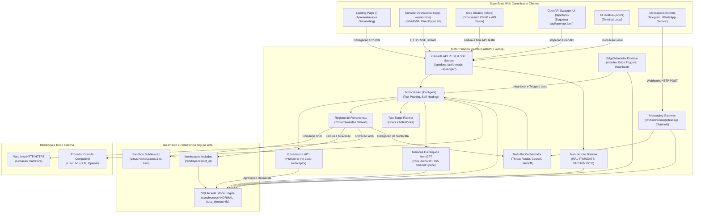
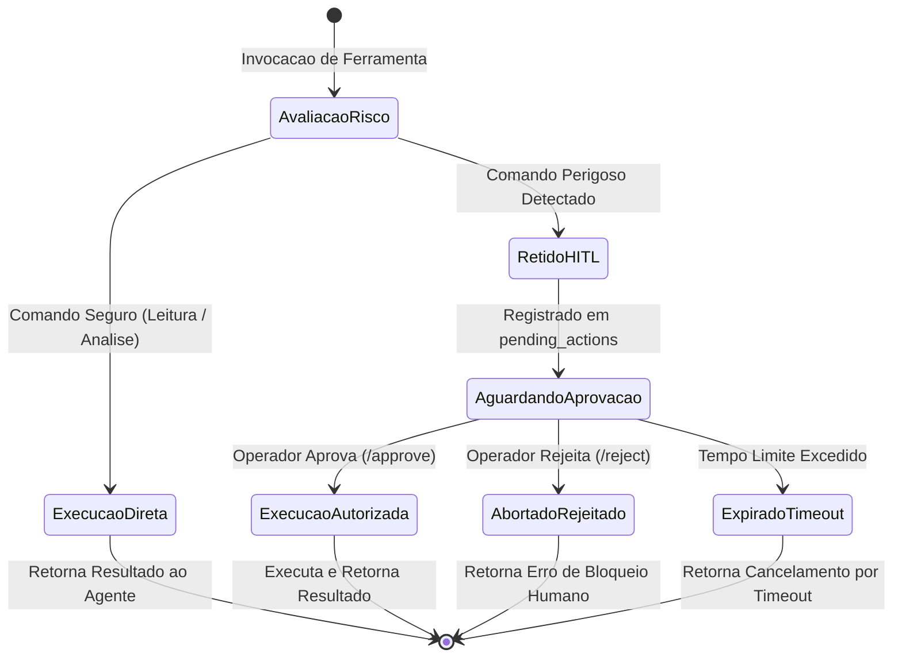
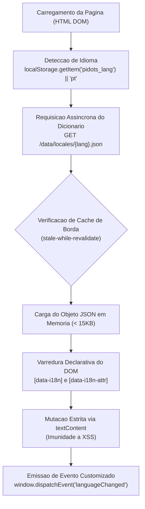
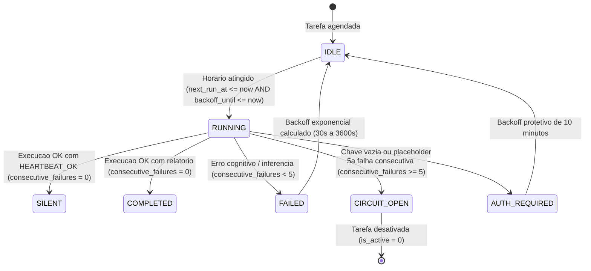
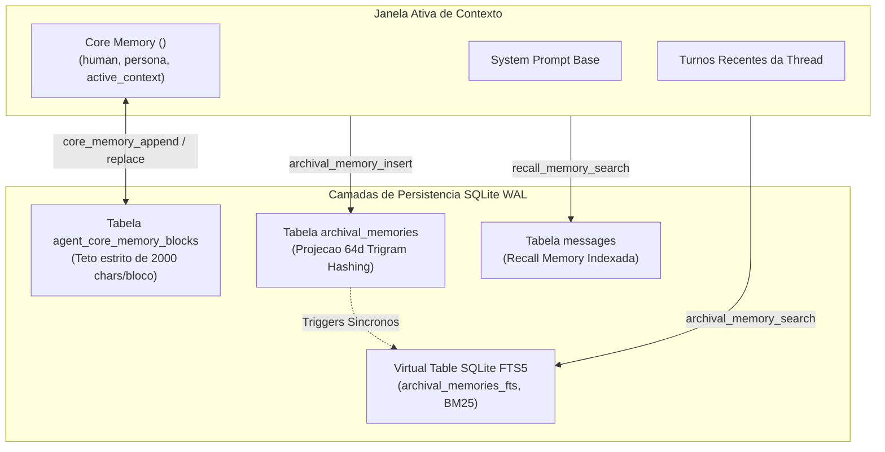
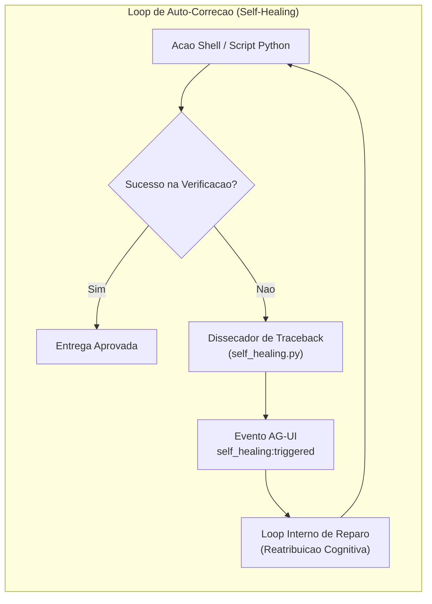
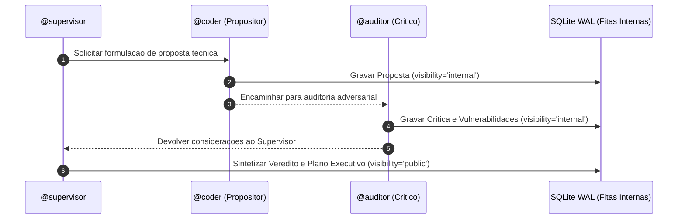
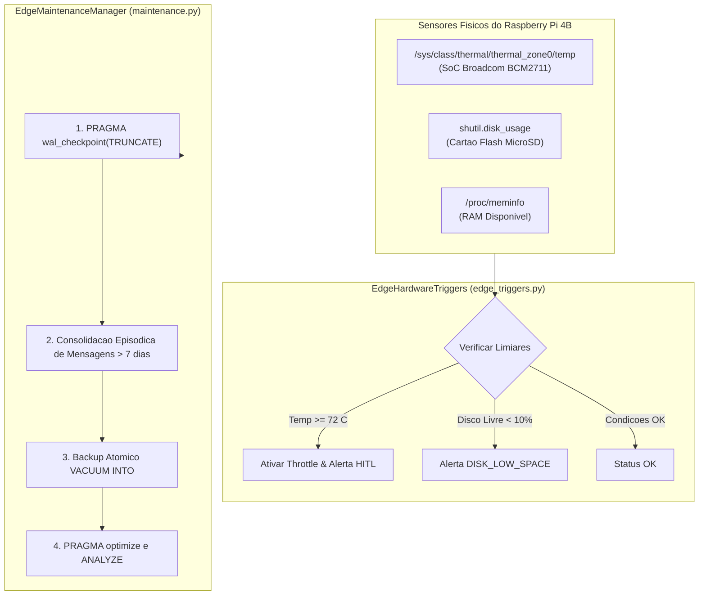

# Arquitetura e Engenharia de Software do piDots

Este documento detalha as decisoes de engenharia, padroes arquiteturais, modelos de concorrencia e otimizacoes de hardware adotadas no desenvolvimento do **piDots** para execucao persistente em ambientes de computacao de borda e dispositivos restritos (SBCs ARM64 / x86_64, tendo o Raspberry Pi 4B 4GB ARM64 como benchmark de referencia).

---

## 1. Visao Geral da Arquitetura

O piDots foi projetado sob o paradigma de **Monólito Modular Assincrono** (Single-Process, Event-Driven). Diferente de arquiteturas corporativas baseadas em microservicos orquestrados ou clusters de conteineres que demandam gigabytes de memoria apenas para overhead de rede e runtimes concorrentes, o piDots consolida todas as capacidades essenciais em um unico processo gerenciado pelo FastAPI e uvloop/AsyncIO.

### Diagrama de Blocos do Sistema e Topologia de Superficies



---

## 2. Ciclo de Vida Cognitivo ReAct e Intercepcao HITL

O agente executa o padrao ReAct (*Reasoning and Acting*) em streaming contínuo. Toda intencao de execucao de ferramenta passa por um analisador de risco deterministico antes da invocacao.

### Fluxo de Execucao Sequencial


---

## 3. Maquina de Estados da Governanca Human-in-the-Loop



---

## 4. Otimizacoes Extremas de I/O e SQLite para Edge (Cartao MicroSD / SSD)

O armazenamento em hardware como o Raspberry Pi 4B baseia-se em cartoes MicroSD (com barramento UHS-I de escrita sequencial lenta) ou discos SSD conectados via USB 3.0. Operacoes continuas de escrita com `fsync` sincrono destroem o desempenho de I/O e degradam prematuramente os blocos flash de memoria.

Para contornar este gargalo, a camada de banco de dados do piDots implementa o SQLite em modo **Write-Ahead Logging (WAL)** com as seguintes diretivas de baixo nivel:

```sql
-- Habilita escrita concorrente nao-bloqueante entre leitores e escritores
PRAGMA journal_mode = WAL;

-- Substitui fsync total por sync seguro apenas nos checkpoints do WAL
-- Evita pausas de I/O no loop assincrono e reduz o desgaste da memoria flash
PRAGMA synchronous = NORMAL;

-- Aloca 64 MB de memoria RAM do Raspberry Pi para cache de paginas
-- Leituras de historico e vetores ocorrem em RAM sem tocar no disco
PRAGMA cache_size = -64000;

-- Define checkpoint automatico do WAL a cada 1.000 paginas (aprox. 4 MB)
-- Impede o crescimento descontrolado do arquivo .db-wal
PRAGMA wal_autocheckpoint = 1000;

-- Define timeout de 5.000 ms para operacoes concorrentes antes de emitir erro de lock
PRAGMA busy_timeout = 5000;

-- Armazena indices temporarios e tabelas transitórias em RAM (tmpfs)
PRAGMA temp_store = MEMORY;
```

---

## 5. Modulos do Monolito Modular Expandido

### 5.1 pidots/core/orchestrator.py (Orquestracao Multi-Bot)
O modulo gerencia dialogos multi-ator em um unico processo assincrono:
- **ThreadRouter:** Analisa mensagens com expressao regular (`@([a-zA-Z0-9_\-]+)`), valida se os agentes existem no SQLite WAL e define o destinatario principal e participantes citados.
- **MultiBotOrchestrator.delegate_subtask():** Executa o padrao Supervisor-Worker. O supervisor invoca o worker em uma thread isolada (`subtask-{handoff_id}`), mantendo o historico principal despoluido. O resultado e sintetizado e registrado na conversa pai como fita de carbono (`visibility: 'internal'`).
- **Tratamento Resiliente de Falhas em Subtarefas:** Caso o worker encontre falha na execucao ou inferencia (status `failed` no evento `run:finished`), o orchestrator intercepta o erro, atualiza a tabela `agent_handoffs` para `FAILED` com sumario tecnico, grava mensagem interna de diagnostico na thread pai (`[FALHA NA SUBTAREFA DE @dot]`) e devolve feedback estruturado (`{'success': False, 'worker_dot_id': ..., 'handoff_id': ..., 'error': ...}`), habilitando o supervisor a reavaliar sua estrategia cognitivamente.
- **MultiBotOrchestrator.handoff_lead():** Realiza a transferencia formal de comando de uma thread para outro Dot especialista quando o dominio da tarefa exigir, atualizando o campo `dot_id` da thread e gerando registro na tabela `agent_handoffs`.

### 5.2 pidots/core/scheduler.py (Dot Heartbeat e Agendamento Proativo)
Elimina a necessidade de filas externas (Celery/RabbitMQ) atraves de um loop in-process leve:
- **EdgeScheduler:** Valida sintaxe croniter e calcula `next_run_at` em UTC no SQLite WAL.
- **heartbeat_worker_loop():** Loop perpetuo (`asyncio.create_task`) disparado no lifespan do FastAPI, varrendo tarefas devidas a cada 15 segundos considerando `next_run_at` e a trava `backoff_until`.
- **Diretriz de Silencio Operacional (HEARTBEAT_OK):** Injeta no prompt de acao a instrucao estrita para responder `HEARTBEAT_OK` caso as condicoes checadas estejam normais. Quando detectado, o status e marcado como `SILENT`, sem despachar notificacoes externas ou gerar lixo no historico.
- **Trava de Exclusao Mutua In-Process:** Conjunto em memoria (`_running_tasks: set[str]`) que registra as tarefas em execucao ativa. Caso um ciclo de raciocinio com o LLM consuma mais de 15 segundos, as varreduras subsequentes ignoram tarefas ja em andamento, impedindo disparos duplicados em cascata e exaustao de memoria RAM.
- **Circuit Breaker e Backoff Exponencial:** Ao detectar falha no ciclo cognitivo (`status == 'FAILED'`), o scheduler incrementa `consecutive_failures` e aplica retardo progressivo (`min(3600, 30 * 2^(n-1))`) persistido em `backoff_until`. Na 5ª falha consecutiva, o circuito abre (`CIRCUIT_OPEN`), desativando a tarefa (`is_active = 0`) para preservar a integridade do nó Edge. Em execucoes com sucesso (`COMPLETED` ou `SILENT`), o contador e zerado.
- **Sanity Check Preventivo de Credenciais (AUTH_REQUIRED):** Caso `AI_API_KEY` esteja vazia ou contenha chaves placeholder, a tarefa e imediatamente pausada com status `AUTH_REQUIRED` e backoff de 10 minutos, sem emitir chamadas de rede inuteis ao gateway remoto.

### 5.3 pidots/core/messaging_gateway.py (Gateway de Mensageria e Salas Tematicas)
Centraliza a entrada de mensagens de plataformas terceiras:
- **UnifiedIncomingMessage:** Modelo Pydantic normalizado com campos `platform`, `sender_id`, `sender_name`, `text`, `reply_target_id`.
- **Adaptadores HTTP Stateless:** Processa requisicoes webhook do Telegram Bot API, Evolution API (WhatsApp) e endpoints genericos sem manter conexoes WebSocket ativas.
- **Integracao Nativa com Evolution API:** Consome `evolution_api_url` e `evolution_api_key` validados pelo Pydantic, despachando mensagens de volta via endpoint `/message/sendText` com indicador de digitacao (`composing`) e delay humanizado sem bloquear a thread principal.
- **ChannelOrchestrator:** Orquestra salas tematicas colaborativas (`channels`).
- **Trava Anti-Recursao de Mensageria:** Bloqueia ciclos infinitos entre bots aplicando um teto estrito de saltos (`hop_count <= 3`), exigencia de mencao explicita entre bots para resposta e diretriz `NO_ACTION` para abster-se silenciosamente quando nao houver agregacao de valor.
- **Resposta Operacional Clara em Falhas:** Se o ciclo de raciocinio falhar por indisponibilidade ou erro de credencial no provedor, o gateway captura o status terminal e envia resposta transparente (`[FALHA OPERACIONAL]: O agente encontrou uma falha de conexão...`) ao interlocutor no Telegram, WhatsApp ou webhook, garantindo que o canal permaneca integro.

### 5.4 pidots/storage/spaces_manager.py (Exportacao Resiliente de Workspaces)
Gerencia a persistencia de documentos, historico de revisoes e exportacao compactada:
- **Agregacao Hibrida no Exportador ZIP:** Ao gerar o arquivo compactado em memoria (`export_workspace_zip`), o motor inspeciona tanto a arvore fisica de arquivos em disco (`workspaces/{dot_id}`) quanto a tabela relacional `spaces` do SQLite WAL.
- **Mecanismo de Fallback:** Documentos salvos no banco que ainda nao tenham sido descarregados para o disco físico sao injetados dinamicamente no buffer ZIP via `zipfile.writestr`, prevenindo a geracao de arquivos ZIP vazios.

### 5.5 pidots/core/notifier.py (Despachante HITL e Compatibilidade Retroativa)
- **HITLNotifier:** Camada assincrona desacoplada de despacho de notificacoes de alto risco via Webhook HTTP e Telegram Bot.
- **Camada de Compatibilidade Retroativa:** Fornece o alias `Notifier = HITLNotifier` e o metodo `notify_hitl_request`, garantindo que chamadas legadas e modulos de background operem sem falhas de importacao ou quebra de contrato.

### 5.6 pidots/storage/memory_manager.py (Memoria Hierarquica MemGPT / Letta)
- **Core Memory:** Blocos residentes in-context (`human`, `persona`, `active_context`) persistidos na tabela `agent_core_memory_blocks` com travas rigidas de caracteres por bloco.
- **Archival Memory Hibrida:** Fatos de longo prazo na tabela `archival_memories` com indexacao automatica via triggers sincronos na Virtual Table SQLite FTS5 (`archival_memories_fts`). Combina BM25 com projecao vetorial esparsa 64d gerada por hashing de 3-gramas e ativacao semantica.
- **Recall Memory:** Busca retrospectiva em mensagens com filtros semanticos in-thread.

### 5.7 pidots/core/self_healing.py (Self-Healing Harness)
- **Extracao Cirurgica de Tracebacks:** Analisa saídas de subprocessos shell e scripts Python. Detecta blocos de traceback, identifica arquivo violado, linha exata e classe da excecao, retornando recomendacao de correcao para o motor cognitivo.
- **Loop AG-UI:** Emite evento `self_healing:triggered` e instrui o ReAct a auto-reparar o codigo antes de responder.

### 5.8 pidots/core/planner.py (Planejamento em Dois Estagios)
- **Gestao de Metas e Marcos:** Persiste objetivos em `goals` e etapas em `milestones` no SQLite WAL.
- **Rastreamento de Progresso:** Atualiza o estado de marcos (`PENDING`, `IN_PROGRESS`, `COMPLETED`, `FAILED`) com evidencias tecnicas objetivas, calculando o percentual de conclusao e gerando o bloco XML `<execution_plan>`.

### 5.9 pidots/core/council.py (Conselho Consultivo Multi-Bot)
- **Deliberacao Dialetica Tripartite:** Orquestra debate formal entre Propositor (`@coder`), Auditor Critico (`@auditor`) e Supervisor Geral (`@supervisor`).
- **Isolamento em Fitas de Carbono:** Mensagens intermediarias gravadas com `visibility: 'internal'`; veredito final publicado com cabecalho `[CONSELHO CONSULTIVO - RESOLUCAO FINAL]`. Limite estrito de 3 rodadas (`MAX_COUNCIL_ROUNDS = 3`) e footprint de RAM &lt; 53MB.

### 5.10 pidots/storage/shared_space.py (Shared Knowledge Space)
- **Quadro Colaborativo In-Thread:** Gerencia notas tecnicas comuns na tabela `thread_shared_notes` indexada por `(thread_id, topic_key)`.
- **Injecao Multilateral:** Formata as notas no bloco XML `<shared_knowledge_space>`, sincronizando o entendimento entre todos os agentes participantes.

### 5.11 pidots/core/dot_pack.py (Templates e Dot Packs v1.0)
- **Especificacao DotPack v1.0:** Empacota definicoes de Dot, arquivos de workspace, blocos de Core Memory e memórias arquivísticas em manifesto JSON portavel.
- **Importacao e Exportacao Atomica:** Restaura workspaces no disco fisico e popula tabelas relacionais do SQLite em uma unica operacao transacional.

### 5.12 pidots/core/edge_triggers.py (Triggers de Hardware Edge)
- **Leitura Direta de Sysfs:** Monitora a temperatura real do SoC Broadcom BCM2711 (`/sys/class/thermal/thermal_zone0/temp`), espaco livre no MicroSD e memoria RAM livre.
- **Avaliacao e Alertas Proativos:** Dispara throttle automatico e despacha notificacoes HITL caso a temperatura ultrapasse 72°C ou o espaco flash caia abaixo de 10%.

### 5.13 pidots/storage/maintenance.py (Manutencao Noturna do MicroSD)
- **Truncamento de WAL:** Executa `PRAGMA wal_checkpoint(TRUNCATE)` para esvaziar o arquivo `-wal` e proteger a memoria flash do MicroSD contra exaustao de escritas.
- **Consolidacao e Poda Episodica:** Sintetiza turnos com mais de 7 dias na tabela `episodic_memories` e remove as mensagens brutas antigas da tabela `messages`.
- **Backup Atomico sem Bloqueio:** Executa `VACUUM INTO` em conexao isolada com autocommit (`isolation_level=None`) e atualiza estatisticas via `PRAGMA optimize`.


---

## 6. Modelagem de Dados Expandida no SQLite WAL

O esquema do piDots foi enriquecido com 9 novas tabelas relacionais em modo Write-Ahead Logging:

| Tabela | Finalidade Operacional | Chaves e Campos Principais |
| :--- | :--- | :--- |
| `thread_participants` | Rastreia associacao N:N de Dots presentes em cada thread | `thread_id`, `dot_id`, `joined_at`, `is_speaker`, `turn_order` |
| `agent_handoffs` | Auditoria de delegacoes de subtarefas e transferencias de comando | `id`, `thread_id`, `source_dot_id`, `target_dot_id`, `task_goal`, `handoff_type`, `status`, `result_summary` |
| `goals` | Metas persistentes do agente para conter dispersao (goal drift) | `id`, `dot_id`, `thread_id`, `title`, `description`, `status`, `priority` |
| `milestones` | Marcos sequenciais verificaveis associados a cada meta | `id`, `goal_id`, `order_index`, `title`, `acceptance_criteria`, `status`, `evidence_summary` |
| `episodic_memories` | Memoria episodica de medio prazo com sumarizacao estruturada | `id`, `dot_id`, `thread_id`, `summary`, `key_decisions`, `modified_artifacts` |
| `scheduled_tasks` | Registro de tarefas proativas cron executadas pelo Heartbeat | `id`, `dot_id`, `task_name`, `cron_expr`, `action_prompt`, `next_run_at`, `last_status`, `consecutive_failures`, `backoff_until`, `is_active` |
| `channels` | Salas tematicas de equipe para colaboracao multi-bot e humana | `id`, `name`, `description`, `created_at` |
| `channel_messages` | Mensagens trocadas nas salas tematicas com rastreio de saltos | `id`, `channel_id`, `author_type`, `author_id`, `content`, `hop_count` |
| `channel_members` | Membros inscritos em cada sala tematica (Dots ou Usuarios) | `channel_id`, `member_type`, `member_id`, `joined_at` |

### Indices de Desempenho para MicroSD
Para manter a latencia de consulta inferior a 5ms em hardware ARM64:
```sql
CREATE INDEX IF NOT EXISTS idx_participants_thread ON thread_participants(thread_id);
CREATE INDEX IF NOT EXISTS idx_handoffs_thread ON agent_handoffs(thread_id, status);
CREATE INDEX IF NOT EXISTS idx_milestones_goal ON milestones(goal_id, order_index);
CREATE INDEX IF NOT EXISTS idx_tasks_due ON scheduled_tasks(is_active, next_run_at, backoff_until);
CREATE INDEX IF NOT EXISTS idx_channel_msgs ON channel_messages(channel_id, created_at);
CREATE INDEX IF NOT EXISTS idx_channel_members ON channel_members(channel_id);
```

---

## 7. Arquetipos Cognitivos e Dynamic Tool Pruning

### 7.1 Filosofia dos Arquetipos
Os agentes cadastrados em `dots` possuem arquetipos cognitivos que guiam suas personas e comportamentos:
- **`supervisor`:** Visao holistica, decomposicao de objetivos em marcos, gestao de estado e delegacao tecnica. Carimbo: `[SPV]`.
- **`grok`:** Foco analitico-convergente, analise forense de codigo linha a linha, deducao de causa raiz, execucao em terminal isolado e testes estritos. Carimbo: `[CDR]`.
- **`muse`:** Foco criativo-divergente, arquitetura de sistemas, sintese de documentos, exploracao conceitual e documentacao tecnica. Carimbo: `[ARC]`.
- **`auditor`:** Validacao de integridade, telemetria termica e de memoria, verificacao de seguranca e conformidade HITL. Carimbo: `[AUD]`.

### 7.2 Dynamic Tool Pruning (Poda Dinamica de Ferramentas)
No processamento de agentes de borda, transmitir a definicao JSON completa de dezenas de ferramentas a cada ciclo satura a janela de contexto dos modelos e consome banda desnecessaria.
- O campo `allowed_tools_json` na tabela `dots` define o subconjunto estrito de ferramentas que o Dot tem permissao para usar (ex: `["delegate_task", "handoff_to_dot"]` para o supervisor; `["execute_shell_command", "workspace_read_file"]` para o coder).
- Durante o `DotAgent.run_thread()`, o motor consulta o `ToolRegistry` passando apenas as ferramentas permitidas.
- **Resultado:** Reducao de mais de 75% na sobrecarga de tokens em cada requisicao e eliminacao completa de alucinacoes de ferramentas nao autorizadas.

---

## 8. Isolamento de Processos via Bubblewrap (`bwrap`)

Para garantir a seguranca do host sem o consumo excessivo de memoria de maquinas virtuais ou conteineres aninhados (Docker-in-Docker), o piDots utiliza o utilitario de sandbox de baixo nivel do kernel Linux **Bubblewrap**:

1. **Isolamento de Namespaces:** O comando e executado em namespaces isolados de montagem de arquivos (`CLONE_NEWNS`), processos (`CLONE_NEWPID`), comunicacao entre processos (`CLONE_NEWIPC`) e hostname (`CLONE_NEWUTS`).
2. **Sistema de Arquivos Read-Only:** Os diretorios criticos do sistema (`/bin`, `/usr`, `/lib`, `/etc`) sao montados no sandbox com permissao estrita de somente leitura (`--ro-bind`).
3. **Workspace Estrito:** O unico diretorio com permissao de escrita e o workspace individual atribuido ao Dot (`--bind {workspaces_root}/{dot_id} /workspace`).
4. **Protecao de Morte de Processo:** A flag `--die-with-parent` garante que processos orfaos ou bifurcacoes maliciosas sejam terminados imediatamente caso o processo principal encerre.

---

## 9. Motor Vetorial CRC32 KNN (Zero-RAM Overhead)

Bancos vetoriais convencionais (ChromaDB, Weaviate, Milvus, Qdrant) dependem de runtime em C++/Rust, PyTorch ou JVM, consumindo entre 300 MB e 1,5 GB de RAM apenas em tempo de inicializacao.

O piDots introduz uma solucao vetorial sob medida para borda:
- **Hashing CRC32 de N-Gramas:** O texto de cada documento e decomposto em n-gramas e projetado em um espaco vetorial esparso de dimensionalidade deterministica usando funcoes de hashing de 32 bits (CPU nativa ARM64 em microssegundos).
- **Similaridade de Cosseno com KNN Puro:** A comparacao semantica e calculada em tempo real diretamente sobre as representacoes armazenadas no banco SQLite.
- **Overhead Operacional:** Menor que **5 MB de RAM**, eliminando completamente bibliotecas pesadas de tensores.

---

## 10. Extracao Semantica Web com Trafilatura

O OpenDots corporativo utiliza Chromium headless ou Playwright para scraping e automacao web, demandando mais de 500 MB de RAM por instancia e consumo agressivo de CPU.

No piDots:
- As requisicoes sao executadas via cliente HTTP assincrono enxuto (`httpx`).
- O parsing do DOM e a remocao de scripts, trackers, propagandas e estilos sao delegados ao **Trafilatura**, um extrator semantico baseado em heuristicas de NLP textual em Python puro.
- **Resultado:** Reducao de consumo de memoria de ~500 MB para ~20 MB de RAM por extracao, mantendo alta fidelidade semantica para compreensao do LLM.

---

## 11. Concorrencia Assincrona e Gestao de Recursos

- **Processo Unico:** Todo o servidor opera em uma unica thread de loop de eventos (`asyncio` com politicas de `uvloop` quando disponivel).
- **Sem Bloqueio de Thread:** Operacoes de I/O de disco (SQLite) e subprocessos (Bash Sandbox) sao executadas usando `asyncio.to_thread` ou `asyncio.create_subprocess_exec`, garantindo que o loop de eventos principal permaneca disponivel para servir requisicoes HTTP e streaming SSE.
- **Coleta de Lixo e Monitoramento de Memoria:** Telemetria nativa via `psutil` reporta o uso de RSS (Resident Set Size) e porcentagem de CPU a cada ciclo de vida, permitindo auditoria em tempo real.

---

## 12. Design System Pixel Paper UI, Roteamento Canonico e Ergonomia Mobile-First

O ecossistema do piDots implementa uma arquitetura de multiplas superficies desacopladas servidas pelo mesmo processo FastAPI, unificadas pelo design system **Pixel Paper UI**:

### 12.1 Topologia Canonica de Superficies e Desacoplamento de Rotas
A informacao foi organizada para eliminar colisoes entre navegacao de produto, operacao tatica de agentes e documentacao tecnica:

| Superficie Canonica | Rota HTTP | Finalidade Arquitetural |
| :--- | :--- | :--- |
| **Landing Page** | `GET /` | Apresentacao do produto, onboarding, calculadora interativa de ROI e demonstracao ReAct |
| **Console Operacional** | `GET /app` | Estacao de trabalho SPA/PWA com os agentes (teletipo, chats, Live Canvas, telemetria) |
| **Alias de Workspace** | `GET /workspace` | Apelido canonico para `/app`, facilitando a digitacao em terminais |
| **Guia Didatico** | `GET /docs` | Documentacao operacional rica, esteira passo a passo, Omnisearch Ctrl+K e Mini API Tester |
| **OpenAPI Swagger UI** | `GET /api/docs` | Interface OpenAPI interativa nativa do FastAPI desacoplada de `/docs` |
| **Esquema OpenAPI JSON** | `GET /api/openapi.json` | Contrato formal OpenAPI 3.0 estruturado em JSON |
| **Dicionarios de Locale** | `GET /data/locales/{lang}.json` | Dicionarios atomicos de localizacao bilingue (PT/EN) com cache de borda |
| **Micro-Motor i18n JS** | `GET /static/pidots-i18n.js` | Micro-motor Vanilla JS de traducao dinamica client-side |
| **Changelog e Patch Notes** | `GET /api/changelog` | Historico SemVer e notas de atualizacao categorizadas (Patch Notes v1.2.0) |
| **Service Worker PWA** | `GET /sw.js` | Service Worker com cache defensivo v5 para operacao offline |
| **Redirecionamentos RFC 7538** | `/apresentacao`, `/guia`, `/console` | Redirecionamentos permanentes HTTP 308 preservando compatibilidade retroativa |

### 12.2 Surface Switcher e Navegacao Cruzada via Chords Globais
As interfaces integram o **Surface Switcher**, um cabeçalho técnico flutuante com telemetria do nó em tempo real e atalhos sequenciais (*chords*) sem teclas modificadoras:
- **Atalhos Chords:**
  - `g` seguido de `h` (*Go Home*): Transicao imediata para a Landing Page (`/`).
  - `g` seguido de `w` (*Go Workspace*): Transicao para o Console Operacional (`/app`).
  - `g` seguido de `d` (*Go Docs*): Transicao para a Documentacao Tecnica (`/docs`).
- **Tratamento de Eventos e Supressao:**
  O listener de teclado valida `event.target.matches('input, textarea, select, [contenteditable]')`. Se o operador estiver digitando no prompt de comando ou na busca, os chords sao desativados para evitar navegacao acidental. Um temporizador de 1.000ms reseta o estado caso a segunda tecla nao seja pressionada.

### 12.3 Atalhos de Alta Produtividade do Console SPA
Para operar 24/7 sem dependencia de mouse:
- `Alt+I`: Inspecionar artefato ativo no Live Canvas.
- `Ctrl+S` / `Cmd+S`: Gravar revisao atomica do documento em Spaces no SQLite WAL (com `preventDefault` para interceptar a gravacao padrao do browser).
- `Alt+H`: Abrir e focar o dossie de governanca HITL pendente.
- `F11`: Alternar entre visualizacao dividida (split) e maximizada do canvas (com supressao do fullscreen nativo).
- `Ctrl+L`: Limpar mensagens visuais da bobina do teletipo/chat local.
- `F1`: Abrir gaveta retratil com o manual operacional tecnico.

### 12.4 Engenharia e Resiliencia Mobile-First para Hardware de Borda
As interfaces foram calibradas para dispositivos moveis (iOS Safari e Android Chrome) operados remotamente via tuneis Cloudflared:
1. **Controle de Teclado Virtual no Android:** Meta viewport configurada com `interactive-widget=resizes-content`, instruindo o motor Blink a redimensionar dinamicamente a viewport visual em vez de sobrepor inputs ou colapsar o scroll.
2. **Protecao Anti-Zoom no iOS Safari:** Regra CSS global `font-size: 16px !important` em todos os elementos de input de texto e buscas, impedindo o disparo de zoom automatico destrutivo da Apple que quebra layouts responsivos fixos.
3. **Viewport Dinamico (100dvh):** Uso de `min-height: 100dvh` (Dynamic Viewport Height) com fallback para `100vh`, acomodando com precisao o surgimento e recolhimento das barras de navegacao de navegadores moveis.
4. **Respeito a Safe Areas:** Utilizacao de `env(safe-area-inset-top)` e `env(safe-area-inset-bottom)` nos cabecalhos e na barra de navegacao inferior (`.mobile-bottom-nav`), garantindo compatibilidade com Dynamic Island e Home Indicators do iOS.
5. **Tap Targets Acessiveis:** Areas minimas de toque de 44x44px em botoes e icones com feedback haptico sutil via `navigator.vibrate` em navegadores compativeis.
6. **Estetica Pixel Paper UI:** Visual tatico inspirado em teletipos tecnicos, fichas catalograficas e papel milimetrado com alta densidade de informacoes, tipografia tecnica crisp, ausencia de filtros graficos pesados e catalogo uniforme de 26 icones SVGs tecnicos. Buffer circular de DOM mantido em 150 nos para prevenir exaustao de memoria em navegadores de borda.

### 12.5 Arquitetura do Micro-Motor de Internacionalização (i18n) e Localização de Borda

Para oferecer suporte nativo bilíngue completo (Português do Brasil `pt-BR` e Inglês Técnico `en-US`) sem dependência de bibliotecas pesadas de terceiros (como `i18next` ou `vue-i18n`), o piDots implementa um micro-motor Vanilla JS assíncrono e atômico (`static/pidots-i18n.js`):



#### Contrato Declarativo de Atributos HTML
O micro-motor realiza a varredura e mutação segura do DOM através de atributos semânticos:

| Atributo DOM | Mecanismo de Atualizacao | Exemplo de Uso |
| :--- | :--- | :--- |
| `data-i18n="chave"` | Mutação estrita de texto via `node.textContent` | `<span data-i18n="nav.overview">VISAO GERAL</span>` |
| `data-i18n-placeholder="chave"` | Atualização segura do atributo `placeholder` | `<input data-i18n-placeholder="guide.search_placeholder" />` |
| `data-i18n-title="chave"` | Atualização do atributo `title` de acessibilidade | `<button data-i18n-title="telemetry.node_title">...</button>` |
| `data-i18n-attr="attr:chave"` | Mapeamento genérico de atributos HTML | `<button data-i18n-attr="aria-label:nav.manual">...</button>` |

#### Proteções de Borda e Resiliência
1. **Imunidade a XSS:** Toda mutação textual utiliza exclusivamente `textContent`, prevenindo qualquer injeção de HTML arbitrário ou execução não autorizada de scripts provindos de traduções.
2. **Cache HTTP Calibrado:** O endpoint `/data/locales/{lang}.json` responde com `Cache-Control: public, max-age=3600, stale-while-revalidate=86400`, eliminando requisições repetidas ao disco MicroSD.
3. **Fallback Dinâmico e Preservação de Tags:** Elementos complexos com formatações filhas (como quebras de linha `<br>` ou badges internos) utilizam spans desacoplados para que a substituição de texto preserve a integridade visual da árvore DOM.

### 12.6 Arquitetura do Protocolo de Slash Commands (/) e Despacho de Borda

O Console Operacional incorpora um motor lexico e despachador assincrono de comandos iniciados por barra (`/`) projetado sob os seguintes pilares tecnicos:

```
+--------------------------------------------------------------------------+
|                 FLUXO ARQUITETURAL DE SLASH COMMANDS                     |
+--------------------------------------------------------------------------+
|                                                                          |
|  [Input: #instructionInput]  --> Digita '/'                              |
|             |                                                            |
|             +--> [SlashCommandsEngine] (Fuzzy Filter in-memory < 10KB)    |
|             |          |                                                 |
|             |          v                                                 |
|             |    Popover Flutuante (7 Abas de Filtro, Setas, Tab/Enter)  |
|             |                                                            |
|             v                                                            |
|  [Submit: transmitInstruction()]                                         |
|             |                                                            |
|             +-- [Prompt comeca com '/']?                                 |
|             |          |                                                 |
|             |        [SIM]                                               |
|             |          v                                                 |
|             |   [executeSlashCommand(cmdLine)]                           |
|             |          |                                                 |
|             |          +-- Match no catalogo de 30 comandos?             |
|             |          |         |                                       |
|             |        [SIM]     [NAO] -> findClosestCommand (Levenshtein) |
|             |          |                                                 |
|             |          v                                                 |
|             |   Execucao Local (< 16ms) / REST Endpoint Direto           |
|             |          |                                                 |
|             |          v                                                 |
|             |   renderSlashReceiptSlip()                                 |
|             |   (Recibo Tatil, SEQ#, Timestamp ISO, Picote Serrilhado)   |
|             |   enforceDomCeiling() -> Teto estrito de 150 nos DOM       |
|             |                                                            |
|           [NAO]                                                          |
|             v                                                            |
|  Fluxo Padrao LLM / SSE (/api/threads/{id}/runs)                         |
+--------------------------------------------------------------------------+
```

1. **Interceptacao no Cliente (< 16ms):** Comandos locais nao realizam chamadas a provedores de LLM, eliminando latencia de rede e consumo de tokens para inspecao de telemetria, configuracao de interface e gerenciamento de sessao.
2. **Buffer Circular de DOM (150 Nós):** A funcao `renderSlashReceiptSlip` integra-se a `enforceDomCeiling`, garantindo que recibos antigos sejam purgados do DOM de forma FIFO estrita, mantendo a pegada de memoria RAM estavel em hardware restrito.
3. **Levenshtein Fault Tolerance:** Algoritmo de distancia de edicao com limite `max_distance <= 3` integrado, sugerindo correcoes imediatas quando erros tipograficos ocorrem.
4. **Isolamento de Escopo e XSS:** Todo texto dinamico e parametro fornecido pelo operador passa por `escapeHtml()` antes da montagem estrutural dos recibos.

---

## 13. Camada de Cabecalhos de Seguranca HTTP e Hardening de Rede de Borda

Para proteger a estacao de trabalho de borda exposta na rede local ou via tuneis remotos (Cloudflared/Tailscale), a aplicacao FastAPI injeta cabecalhos defensivos de seguranca em todas as respostas HTTP processadas pelo middleware assincrono:
1. **`X-Content-Type-Options: nosniff`:** Impede que navegadores realizem inferencia de tipos MIME em artefatos, respostas textuais ou scripts servidos, eliminando vetores de exploracao de conteudo estatico malicioso.
2. **`X-Frame-Options: SAMEORIGIN`:** Impede que dominios de terceiros incorporem o console operacional SPA, o guia ou a landing page dentro de frames externos, neutralizando ataques de clickjacking.
3. **`Referrer-Policy: strict-origin-when-cross-origin`:** Garante que dados de contexto, caminhos internos de rotas ou parametros de query nao vazem para servicos externos ao navegar a partir da aplicacao.

---

## 14. Arquitetura de Resiliencia Cognitiva, Circuit Breaker e Contratos AG-UI v1.0

A operacao autonoma continua 24/7 em hardware de borda (Raspberry Pi 4B) impoe que falhas de rede, oscilacoes de latencia, limites de taxa ou credenciais invalidas no provedor remoto de LLM sejam tratadas de forma deterministica, sem travar o loop de eventos, sem corromper o estado do banco e sem gerar falsos positivos operacionais.

### 14.1 Hierarquia de Excecoes Tipadas e Short-Circuit

O modulo `pidots/providers/openai_client.py` define uma taxonomia clara para diferenciar falhas recuperaveis de irrecuperaveis:


1. **`ProviderAuthError` (Irrecuperavel):** Disparado em respostas HTTP 401 (Unauthorized) ou HTTP 403 (Forbidden). Aplica **short-circuit imediato**, abortando o ciclo ReAct sem realizar retentativas inuteis que sobrecarregariam a CPU e consumiriam banda de rede.
2. **`ProviderTransientError` (Recuperavel com Backoff):** Disparado em erros transitorios HTTP 503 (Service Unavailable), HTTP 429 (Rate Limit), HTTP 502/504 ou falhas de conexao/timeout de rede (`ConnectError`, `ReadTimeout`). Realiza retentativas controladas com backoff exponencial e jitter pseudo-aleatorio (`delays = [1.0, 2.0, 4.0] + random.uniform(0.1, 0.5)`). Caso as tentativas se esgotem, levanta `ProviderTransientError`.

### 14.2 Padronizacao do Contrato AG-UI v1.0 e Fita de Carbono Interna

Durante a execucao de `DotAgent.run_thread()`, o ciclo ReAct assegura que falhas de inferencia emitam eventos estruturados e mensagens de rastreabilidade:

1. **Emissao Padronizada de `run:finished`:**
   Ao capturar `ProviderAuthError` ou `ProviderTransientError`, o gerador assincrono emite:
   ```json
   {
     "event": "run:finished",
     "data": {
       "run_id": "uuid-da-execucao",
       "status": "failed",
       "final_response": "",
       "error": "Descricao tecnica da falha",
       "error_type": "auth_error"
     }
   }
   ```
2. **Fita Interna de Diagnostico (Carbon Tape):**
   Antes de emitir o encerramento da thread, o agente insere uma mensagem de diagnostico no SQLite WAL com o campo `visibility = 'internal'`:
   - Conteudo: `[FALHA DE AUTENTICAÇÃO]: ...` ou `[FALHA DE INFERÊNCIA]: ...`.
   - Isso permite auditoria forense completa via painel administrativo ou CLI sem expor detalhes internos tecnicos no feed principal do usuario.

### 14.3 Resiliencia dos Tres Consumidores Arquiteturais

Os tres componentes que orquestram a execucao do `DotAgent` consomem o evento `run:finished` com tratamento defensivo especializado:

| Consumidor | Modulo | Comportamento em Falha (`status == 'failed'`) | Impacto Arquitetural |
| :--- | :--- | :--- | :--- |
| **EdgeScheduler** | `pidots/core/scheduler.py` | Marca `last_status = 'FAILED'`, persiste sumario real do erro em `last_result_summary` e aciona o calculo de backoff. | Elimina falsos positivos de `COMPLETED` em tarefas cron. |
| **MessagingGateway** | `pidots/core/messaging_gateway.py` | Detecta falha e despacha aviso amigavel `[FALHA OPERACIONAL]: O agente encontrou uma falha de conexao...` para o Telegram, WhatsApp ou webhook. | Evita silencio operacional ou mensagens vazias enviadas aos canais externos. |
| **MultiBotOrchestrator** | `pidots/core/orchestrator.py` | Atualiza o registro em `agent_handoffs` para `status = 'FAILED'`, emite alerta interno `[FALHA NA SUBTAREFA DE @dot]` na thread principal e retorna `{'success': False, 'error': ...}`. | Notifica o supervisor programaticamente, permitindo replanejamento sem travar a thread. |

### 14.4 Maquina de Estados do Circuit Breaker em Tarefas Proativas

Para impedir tempestades de reconexao (*retry storms*) em falhas continuas de infraestrutura ou chaves expiradas, o escalonador `EdgeScheduler` implementa um Circuit Breaker com as seguintes regras de transicao:



1. **Calculo do Backoff Exponencial:**
   Em cada falha consecutiva, o retardo de backoff e calculado deterministica e progressivamente atraves de `min(3600, 30 * 2^(n-1))`:
   - Falha 1: 30 segundos
   - Falha 2: 60 segundos
   - Falha 3: 120 segundos
   - Falha 4: 240 segundos
   - O campo `backoff_until` e atualizado no SQLite WAL, impedindo execucoes antes do prazo.
2. **Abertura do Circuito (`CIRCUIT_OPEN`):**
   Na 5ª falha consecutiva, o circuito abre. O registro recebe `last_status = 'CIRCUIT_OPEN'` e `is_active = 0`. A tarefa e desativada de forma segura ate intervencao manual do operador.
3. **Sanity Check Preventivo de Chaves (`AUTH_REQUIRED`):**
   Antes de instanciar o agente, o scheduler verifica se a credencial do provedor e uma string vazia ou placeholder (`sua_chave_aqui`, `placeholder`). Se detectada, a tarefa recebe `last_status = 'AUTH_REQUIRED'`, `backoff_until = now + 10min` e nao realiza nenhuma chamada externa, poupando energia e recursos de rede do Raspberry Pi.

---

## 15. Subsistema de Memoria Hierarquica Autonoma (MemGPT / Letta)

Para superar a amnesia sem sobrecarregar a janela de contexto, o modulo `pidots/storage/memory_manager.py` implementa uma arquitetura de memoria em 3 camadas inspirada no MemGPT/Letta:



1. **Core Memory In-Context:**
   - Injetada diretamente no system prompt sob o bloco XML `<core_memory>`.
   - Limite por bloco (`max_chars = 2000`) impedindo extrapolacao de tokens.
   - Ferramentas nativas `core_memory_append` e `core_memory_replace` que o proprio agente executa quando aprende preferencias do usuario ou atualiza seu foco operacional.
2. **Archival Memory com Busca Hibrida BM25 + 64d:**
   - Base duradoura de fatos e documentacoes indexada na Virtual Table `archival_memories_fts` via triggers SQL nativos (`trg_archival_insert`, `trg_archival_update`, `trg_archival_delete`).
   - Algoritmo de projecao esparsa `compute_compact_embedding`: calcula um vetor de 64 dimensoes combinando hash de trigramas (3-grams) e ativacao semantica pura em CPU, com pontuacao hibrida `score = abs(rank) + similaridade * 0.5`.
3. **Recall Memory:**
   - Ferramenta `recall_memory_search` que consulta turnos e decisoes anteriores da conversa diretamente na tabela `messages`.

---

## 16. Subsistema de Self-Healing Harness e Planejamento em Dois Estagios



1. **Self-Healing Harness (`pidots/core/self_healing.py`):**
   - Ferramenta `execute_and_verify`: exige um comando principal e um comando de verificacao (ex: `pytest` ou `python3 -m py_compile`).
   - Em caso de codigo de saida diferente de zero ou presenca de traceback, o analisador isola o arquivo, linha e nome da excecao, devolvendo recomendacao tecnica direta de correcao para o agente.
2. **Two-Stage Planning (`pidots/core/planner.py`):**
   - Tabela `goals` (metas gerais) e tabela `milestones` (marcos ordenados).
   - O agente cria o plano com `plan_create`, avanca etapas com `plan_update_step` comprovando evidencias tecnicas (`evidence_summary`), e consulta o progresso com `plan_get_status`.
   - O progresso percentual e recalculado atomicamente e injetado no prompt sob `<execution_plan>`.

---

## 17. Conselho Consultivo e Deliberacao Dialetica Multi-Bot



- **Papéis Estritos:** Propositor formula o codigo ou arquitetura; Critico aponta brechas de seguranca, concorrencia e consumo de memoria; Supervisor sintetiza a versao definitiva.
- **Fitas de Carbono:** Mensagens do debate possuem `visibility = 'internal'`, mantendo o feed publico conciso.
- **Resolucao Publica:** O veredito executivo e gravado com cabecalho formal `[CONSELHO CONSULTIVO - RESOLUCAO FINAL]` e `visibility = 'public'`.
- **Contencao de Hardware:** Trava rigida de no maximo 3 rodadas (`MAX_COUNCIL_ROUNDS = 3`), operando com consumo estritamente inferior a 53 MB de RAM.

---

## 18. Shared Knowledge Space e Templates Dot Packs v1.0

1. **Shared Knowledge Space (`pidots/storage/shared_space.py`):**
   - Quadro colaborativo indexado por `(thread_id, topic_key)` na tabela `thread_shared_notes`.
   - Permite que multiplos agentes gravem notas tecnicas com `shared_space_write` e consultem com `shared_space_read`.
   - O conteudo e compilado no bloco XML `<shared_knowledge_space>` e entregue a todos os interlocutores da conversa.
2. **Dot Packs v1.0 (`pidots/core/dot_pack.py`):**
   - Manifesto padronizado JSON contendo persona, arquetipo, ferramentas, blocos de Core Memory, memórias arquivísticas e snapshot de arquivos do workspace.
   - Endpoints REST: `GET /api/dots/{dot_id}/export-pack` para geracao do manifesto e `POST /api/dots/import-pack` para instanciacao atomica de novos agentes em qualquer Raspberry Pi.

---

## 19. Triggers de Hardware Edge e Manutencao Noturna do MicroSD



1. **Event-Driven Hardware Triggers (`pidots/core/edge_triggers.py`):**
   - Leitura direta via sysfs de `/sys/class/thermal/thermal_zone0/temp`.
   - Avaliacao a cada ~60s no loop proativo do `scheduler.py` ou sob demanda via `hardware_trigger_check` e rota `GET /api/edge/triggers`.
   - Se temperatura $\ge 72°C$ (`settings.thermal_limit_celsius`), classifica como `WARNING` ou `CRITICAL` ($\ge 78°C$) e despacha alerta HITL imediato ao operador.
2. **Preservacao Radical do MicroSD (`pidots/storage/maintenance.py`):**
   - `PRAGMA wal_checkpoint(TRUNCATE)` sincroniza e esvazia o arquivo `-wal`, prevenindo desgaste de celulas flash.
   - Consolida mensagens antigas (> 7 dias) na tabela `episodic_memories` e poda mensagens brutas para economizar blocos de armazenamento.
   - Executa `VACUUM INTO` em conexao isolada com autocommit (`isolation_level=None`), gerando backups sem bloqueio concorrente.
   - Endpoint: `POST /api/edge/maintenance`.


