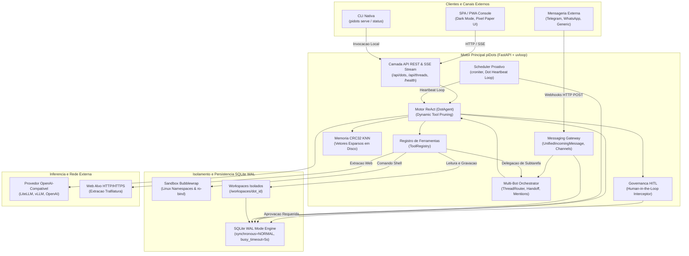
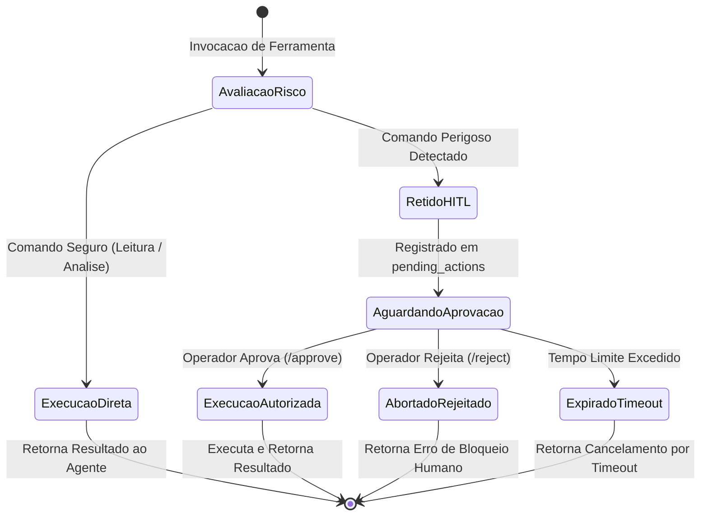

# Arquitetura e Engenharia de Software do piDots

Este documento detalha as decisoes de engenharia, padroes arquiteturais, modelos de concorrencia e otimizacoes de hardware adotadas no desenvolvimento do **piDots** para execucao persistente em ambientes com recursos estritamente limitados (Raspberry Pi 4B 4GB ARM64).

---

## 1. Visao Geral da Arquitetura

O piDots foi projetado sob o paradigma de **Monólito Modular Assincrono** (Single-Process, Event-Driven). Diferente de arquiteturas corporativas baseadas em microservicos orquestrados ou clusters de conteineres que demandam gigabytes de memoria apenas para overhead de rede e runtimes concorrentes, o piDots consolida todas as capacidades essenciais em um unico processo gerenciado pelo FastAPI e uvloop/AsyncIO.

### Diagrama de Blocos do Sistema



---

## 2. Ciclo de Vida Cognitivo ReAct e Intercepcao HITL

O agente executa o padrao ReAct (*Reasoning and Acting*) em streaming contínuo. Toda intencao de execucao de ferramenta passa por um analisador de risco deterministico antes da invocacao.

### Fluxo de Execucao Sequencial


---

## 3. Maquina de Estados da Governanca Human-in-the-Loop



---

## 4. Otimizacoes Extremas de I/O e SQLite para Edge (Cartao MicroSD / SSD)

O armazenamento em hardware como o Raspberry Pi 4B baseia-se em cartoes MicroSD (com barramento UHS-I de escrita sequencial lenta) ou discos SSD conectados via USB 3.0. Operacoes continuas de escrita com `fsync` sincrono destroem o desempenho de I/O e degradam prematuramente os blocos flash de memoria.

Para contornar este gargalo, a camada de banco de dados do piDots implementa o SQLite em modo **Write-Ahead Logging (WAL)** com as seguintes diretivas de baixo nivel:

```sql
-- Habilita escrita concorrente nao-bloqueante entre leitores e escritores
PRAGMA journal_mode = WAL;

-- Substitui fsync total por sync seguro apenas nos checkpoints do WAL
-- Evita pausas de I/O no loop assincrono e reduz o desgaste da memoria flash
PRAGMA synchronous = NORMAL;

-- Aloca 64 MB de memoria RAM do Raspberry Pi para cache de paginas
-- Leituras de historico e vetores ocorrem em RAM sem tocar no disco
PRAGMA cache_size = -64000;

-- Define checkpoint automatico do WAL a cada 1.000 paginas (aprox. 4 MB)
-- Impede o crescimento descontrolado do arquivo .db-wal
PRAGMA wal_autocheckpoint = 1000;

-- Define timeout de 5.000 ms para operacoes concorrentes antes de emitir erro de lock
PRAGMA busy_timeout = 5000;

-- Armazena indices temporarios e tabelas transitórias em RAM (tmpfs)
PRAGMA temp_store = MEMORY;
```

---

## 5. Modulos do Monolito Modular Expandido

### 5.1 pidots/core/orchestrator.py (Orquestracao Multi-Bot)
O modulo gerencia dialogos multi-ator em um unico processo assincrono:
- **ThreadRouter:** Analisa mensagens com expressao regular (`@([a-zA-Z0-9_\-]+)`), valida se os agentes existem no SQLite WAL e define o destinatario principal e participantes citados.
- **MultiBotOrchestrator.delegate_subtask():** Executa o padrao Supervisor-Worker. O supervisor invoca o worker em uma thread isolada (`subtask-{handoff_id}`), mantendo o historico principal despoluido. O resultado e sintetizado e registrado na conversa pai como fita de carbono (`visibility: 'internal'`).
- **MultiBotOrchestrator.handoff_lead():** Realiza a transferencia formal de comando de uma thread para outro Dot especialista quando o dominio da tarefa exigir, atualizando o campo `dot_id` da thread e gerando registro na tabela `agent_handoffs`.

### 5.2 pidots/core/scheduler.py (Dot Heartbeat e Agendamento Proativo)
Elimina a necessidade de filas externas (Celery/RabbitMQ) atraves de um loop in-process leve:
- **EdgeScheduler:** Valida sintaxe croniter e calcula `next_run_at` em UTC no SQLite WAL.
- **heartbeat_worker_loop():** Loop perpetuo (`asyncio.create_task`) disparado no lifespan do FastAPI, varrendo tarefas devidas a cada 15 segundos.
- **Diretriz de Silencio Operacional (HEARTBEAT_OK):** Injeta no prompt de acao a instrucao estrita para responder `HEARTBEAT_OK` caso as condicoes checadas estejam normais. Quando detectado, o status e marcado como `SILENT`, sem despachar notificacoes externas ou gerar lixo no historico.
- **Trava de Exclusao Mutua In-Process:** Conjunto em memoria (`_running_tasks: set[str]`) que registra as tarefas em execucao ativa. Caso um ciclo de raciocinio com o LLM consuma mais de 15 segundos, as varreduras subsequentes ignoram tarefas ja em andamento, impedindo disparos duplicados em cascata e exaustao de memoria RAM.

### 5.3 pidots/core/messaging_gateway.py (Gateway de Mensageria e Salas Tematicas)
Centraliza a entrada de mensagens de plataformas terceiras:
- **UnifiedIncomingMessage:** Modelo Pydantic normalizado com campos `platform`, `sender_id`, `sender_name`, `text`, `reply_target_id`.
- **Adaptadores HTTP Stateless:** Processa requisicoes webhook do Telegram Bot API, Evolution API (WhatsApp) e endpoints genericos sem manter conexoes WebSocket ativas.
- **Integracao Nativa com Evolution API:** Consome `evolution_api_url` e `evolution_api_key` validados pelo Pydantic, despachando mensagens de volta via endpoint `/message/sendText` com indicador de digitacao (`composing`) e delay humanizado sem bloquear a thread principal.
- **ChannelOrchestrator:** Orquestra salas tematicas colaborativas (`channels`).
- **Trava Anti-Recursao de Mensageria:** Bloqueia ciclos infinitos entre bots aplicando um teto estrito de saltos (`hop_count <= 3`), exigencia de mencao explicita entre bots para resposta e diretriz `NO_ACTION` para abster-se silenciosamente quando nao houver agregacao de valor.

### 5.4 pidots/storage/spaces_manager.py (Exportacao Resiliente de Workspaces)
Gerencia a persistencia de documentos, historico de revisoes e exportacao compactada:
- **Agregacao Hibrida no Exportador ZIP:** Ao gerar o arquivo compactado em memoria (`export_workspace_zip`), o motor inspeciona tanto a arvore fisica de arquivos em disco (`workspaces/{dot_id}`) quanto a tabela relacional `spaces` do SQLite WAL.
- **Mecanismo de Fallback:** Documentos salvos no banco que ainda nao tenham sido descarregados para o disco físico sao injetados dinamicamente no buffer ZIP via `zipfile.writestr`, prevenindo a geracao de arquivos ZIP vazios.

### 5.5 pidots/core/notifier.py (Despachante HITL e Compatibilidade Retroativa)
- **HITLNotifier:** Camada assincrona desacoplada de despacho de notificacoes de alto risco via Webhook HTTP e Telegram Bot.
- **Camada de Compatibilidade Retroativa:** Fornece o alias `Notifier = HITLNotifier` e o metodo `notify_hitl_request`, garantindo que chamadas legadas e modulos de background operem sem falhas de importacao ou quebra de contrato.

---

## 6. Modelagem de Dados Expandida no SQLite WAL

O esquema do piDots foi enriquecido com 9 novas tabelas relacionais em modo Write-Ahead Logging:

| Tabela | Finalidade Operacional | Chaves e Campos Principais |
| :--- | :--- | :--- |
| `thread_participants` | Rastreia associacao N:N de Dots presentes em cada thread | `thread_id`, `dot_id`, `joined_at`, `is_speaker`, `turn_order` |
| `agent_handoffs` | Auditoria de delegacoes de subtarefas e transferencias de comando | `id`, `thread_id`, `source_dot_id`, `target_dot_id`, `task_goal`, `handoff_type`, `status`, `result_summary` |
| `goals` | Metas persistentes do agente para conter dispersao (goal drift) | `id`, `dot_id`, `thread_id`, `title`, `description`, `status`, `priority` |
| `milestones` | Marcos sequenciais verificaveis associados a cada meta | `id`, `goal_id`, `order_index`, `title`, `acceptance_criteria`, `status`, `evidence_summary` |
| `episodic_memories` | Memoria episodica de medio prazo com sumarizacao estruturada | `id`, `dot_id`, `thread_id`, `summary`, `key_decisions`, `modified_artifacts` |
| `scheduled_tasks` | Registro de tarefas proativas cron executadas pelo Heartbeat | `id`, `dot_id`, `task_name`, `cron_expr`, `action_prompt`, `next_run_at`, `last_status`, `is_active` |
| `channels` | Salas tematicas de equipe para colaboracao multi-bot e humana | `id`, `name`, `description`, `created_at` |
| `channel_messages` | Mensagens trocadas nas salas tematicas com rastreio de saltos | `id`, `channel_id`, `author_type`, `author_id`, `content`, `hop_count` |
| `channel_members` | Membros inscritos em cada sala tematica (Dots ou Usuarios) | `channel_id`, `member_type`, `member_id`, `joined_at` |

### Indices de Desempenho para MicroSD
Para manter a latencia de consulta inferior a 5ms em hardware ARM64:
```sql
CREATE INDEX IF NOT EXISTS idx_participants_thread ON thread_participants(thread_id);
CREATE INDEX IF NOT EXISTS idx_handoffs_thread ON agent_handoffs(thread_id, status);
CREATE INDEX IF NOT EXISTS idx_milestones_goal ON milestones(goal_id, order_index);
CREATE INDEX IF NOT EXISTS idx_tasks_due ON scheduled_tasks(is_active, next_run_at);
CREATE INDEX IF NOT EXISTS idx_channel_msgs ON channel_messages(channel_id, created_at);
CREATE INDEX IF NOT EXISTS idx_channel_members ON channel_members(channel_id);
```

---

## 7. Arquetipos Cognitivos e Dynamic Tool Pruning

### 7.1 Filosofia dos Arquetipos
Os agentes cadastrados em `dots` possuem arquetipos cognitivos que guiam suas personas e comportamentos:
- **`supervisor`:** Visao holistica, decomposicao de objetivos em marcos, gestao de estado e delegacao tecnica. Carimbo: `[SPV]`.
- **`grok`:** Foco analitico-convergente, analise forense de codigo linha a linha, deducao de causa raiz, execucao em terminal isolado e testes estritos. Carimbo: `[CDR]`.
- **`muse`:** Foco criativo-divergente, arquitetura de sistemas, sintese de documentos, exploracao conceitual e documentacao tecnica. Carimbo: `[ARC]`.
- **`auditor`:** Validacao de integridade, telemetria termica e de memoria, verificacao de seguranca e conformidade HITL. Carimbo: `[AUD]`.

### 7.2 Dynamic Tool Pruning (Poda Dinamica de Ferramentas)
No processamento de agentes de borda, transmitir a definicao JSON completa de dezenas de ferramentas a cada ciclo satura a janela de contexto dos modelos e consome banda desnecessaria.
- O campo `allowed_tools_json` na tabela `dots` define o subconjunto estrito de ferramentas que o Dot tem permissao para usar (ex: `["delegate_task", "handoff_to_dot"]` para o supervisor; `["execute_shell_command", "workspace_read_file"]` para o coder).
- Durante o `DotAgent.run_thread()`, o motor consulta o `ToolRegistry` passando apenas as ferramentas permitidas.
- **Resultado:** Reducao de mais de 75% na sobrecarga de tokens em cada requisicao e eliminacao completa de alucinacoes de ferramentas nao autorizadas.

---

## 8. Isolamento de Processos via Bubblewrap (`bwrap`)

Para garantir a seguranca do host sem o consumo excessivo de memoria de maquinas virtuais ou conteineres aninhados (Docker-in-Docker), o piDots utiliza o utilitario de sandbox de baixo nivel do kernel Linux **Bubblewrap**:

1. **Isolamento de Namespaces:** O comando e executado em namespaces isolados de montagem de arquivos (`CLONE_NEWNS`), processos (`CLONE_NEWPID`), comunicacao entre processos (`CLONE_NEWIPC`) e hostname (`CLONE_NEWUTS`).
2. **Sistema de Arquivos Read-Only:** Os diretorios criticos do sistema (`/bin`, `/usr`, `/lib`, `/etc`) sao montados no sandbox com permissao estrita de somente leitura (`--ro-bind`).
3. **Workspace Estrito:** O unico diretorio com permissao de escrita e o workspace individual atribuido ao Dot (`--bind {workspaces_root}/{dot_id} /workspace`).
4. **Protecao de Morte de Processo:** A flag `--die-with-parent` garante que processos orfaos ou bifurcacoes maliciosas sejam terminados imediatamente caso o processo principal encerre.

---

## 9. Motor Vetorial CRC32 KNN (Zero-RAM Overhead)

Bancos vetoriais convencionais (ChromaDB, Weaviate, Milvus, Qdrant) dependem de runtime em C++/Rust, PyTorch ou JVM, consumindo entre 300 MB e 1,5 GB de RAM apenas em tempo de inicializacao.

O piDots introduz uma solucao vetorial sob medida para borda:
- **Hashing CRC32 de N-Gramas:** O texto de cada documento e decomposto em n-gramas e projetado em um espaco vetorial esparso de dimensionalidade deterministica usando funcoes de hashing de 32 bits (CPU nativa ARM64 em microssegundos).
- **Similaridade de Cosseno com KNN Puro:** A comparacao semantica e calculada em tempo real diretamente sobre as representacoes armazenadas no banco SQLite.
- **Overhead Operacional:** Menor que **5 MB de RAM**, eliminando completamente bibliotecas pesadas de tensores.

---

## 10. Extracao Semantica Web com Trafilatura

O OpenDots corporativo utiliza Chromium headless ou Playwright para scraping e automacao web, demandando mais de 500 MB de RAM por instancia e consumo agressivo de CPU.

No piDots:
- As requisicoes sao executadas via cliente HTTP assincrono enxuto (`httpx`).
- O parsing do DOM e a remocao de scripts, trackers, propagandas e estilos sao delegados ao **Trafilatura**, um extrator semantico baseado em heuristicas de NLP textual em Python puro.
- **Resultado:** Reducao de consumo de memoria de ~500 MB para ~20 MB de RAM por extracao, mantendo alta fidelidade semantica para compreensao do LLM.

---

## 11. Concorrencia Assincrona e Gestao de Recursos

- **Processo Unico:** Todo o servidor opera em uma unica thread de loop de eventos (`asyncio` com politicas de `uvloop` quando disponivel).
- **Sem Bloqueio de Thread:** Operacoes de I/O de disco (SQLite) e subprocessos (Bash Sandbox) sao executadas usando `asyncio.to_thread` ou `asyncio.create_subprocess_exec`, garantindo que o loop de eventos principal permaneca disponivel para servir requisicoes HTTP e streaming SSE.
- **Coleta de Lixo e Monitoramento de Memoria:** Telemetria nativa via `psutil` reporta o uso de RSS (Resident Set Size) e porcentagem de CPU a cada ciclo de vida, permitindo auditoria em tempo real.

---

## 12. Design System Pixel Paper UI e Interface SPA/PWA

O console do piDots e servido diretamente pelo FastAPI na rota raiz (`GET /`), incorporando uma arquitetura Single Page Application (SPA) progressiva (PWA) sob o design system **Pixel Paper UI**:
1. **Estetica Tatil Pixel Paper UI:** Combina a sobriedade de fichas catalograficas e teletipos com a precisao geometrica de cantos chanfrados em degraus (`--px: 2px`), sombras duras de 1-bit sem desfoque e paleta de alto contraste (Dark Noir e Blueprint).
2. **Iconografia SVG Tecnica Padronizada:** A interface utiliza um catalogo uniforme de 26 icones vetoriais desenhados com traçado limpo (`stroke-width: 2`, `stroke-linecap: round`), eliminando emojis e dependencias pesadas de fontes externas.
3. **Logotipo Vetorial Oficial:** Marca geometrica servida via rota estatica `/icon.svg` com headers HTTP de cache prolongado (24h), simbolizando dois agentes conectados em verde fosforo (`#10b981`) e ciano (`#38bdf8`).
4. **Consolidacao de Interfaces:** A estetica Pixel Paper UI unifica o console SPA operacional (`/`), a landing page institucional (`/apresentacao`) e o guia interativo (`/guia`), garantindo coerencia visual em todas as rotas do ecossistema.
5. **Buffer Circular de DOM:** O terminal de execucao no frontend mantem teto rigido de 150 nos DOM para evitar vazamento de memoria em navegadores de dispositivos embarcados.

---

## 13. Camada de Cabecalhos de Seguranca HTTP e Hardening de Rede de Borda

Para proteger a estacao de trabalho de borda exposta na rede local ou via tuneis remotos (Cloudflared/Tailscale), a aplicacao FastAPI injeta cabecalhos defensivos de seguranca em todas as respostas HTTP processadas pelo middleware assincrono:
1. **`X-Content-Type-Options: nosniff`:** Impede que navegadores realizem inferencia de tipos MIME em artefatos, respostas textuais ou scripts servidos, eliminando vetores de exploracao de conteudo estatico malicioso.
2. **`X-Frame-Options: SAMEORIGIN`:** Impede que dominios de terceiros incorporem o console operacional SPA, o guia ou a landing page dentro de frames externos, neutralizando ataques de clickjacking.
3. **`Referrer-Policy: strict-origin-when-cross-origin`:** Garante que dados de contexto, caminhos internos de rotas ou parametros de query nao vazem para servicos externos ao navegar a partir da aplicacao.
