# Arquitetura e Engenharia de Software do piDots

Este documento detalha as decisões de engenharia, padrões arquiteturais, modelos de concorrência e otimizações de hardware adotadas no desenvolvimento do **piDots** para execução persistente em ambientes de computação de borda e dispositivos restritos (SBCs ARM64 / x86_64, tendo o Raspberry Pi 4B 4GB ARM64 como benchmark de referência).

---

## 1. Visão Geral da Arquitetura

O piDots foi projetado sob o paradigma de **Monólito Modular Assíncrono** (Single-Process, Event-Driven). Diferente de arquiteturas corporativas baseadas em microsserviços orquestrados ou clusters de contêineres que demandam gigabytes de memória apenas para overhead de rede e runtimes concorrentes, o piDots consolida todas as capacidades essenciais em um único processo gerenciado pelo FastAPI e uvloop/AsyncIO.

### Diagrama de Blocos do Sistema e Topologia de Superfícies

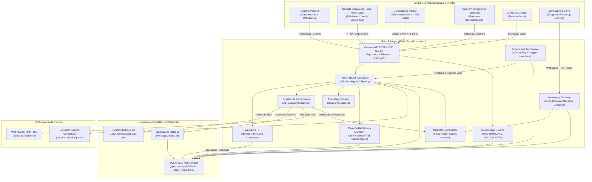

---

## 2. Ciclo de Vida Cognitivo ReAct e Intercepção HITL

O agente executa o padrão ReAct (*Reasoning and Acting*) em streaming contínuo. Toda intenção de execução de ferramenta passa por um analisador de risco determinístico antes da invocação.

### Fluxo de Execução Sequencial

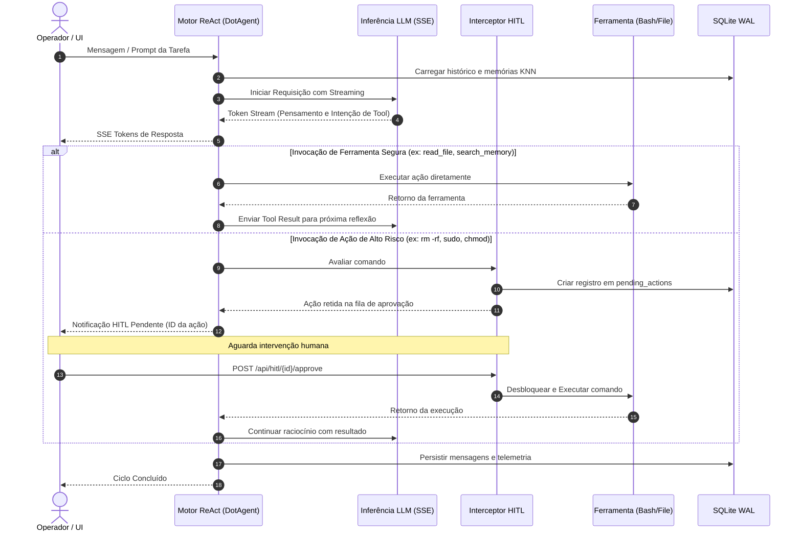

---

## 3. Máquina de Estados da Governança Human-in-the-Loop

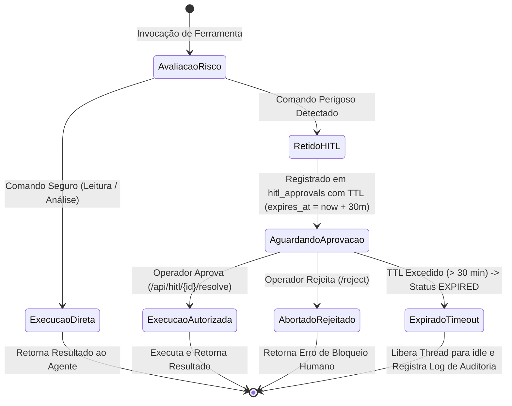

- **TTL Nativo (30 Minutos):** Cada solicitação pendente armazena `expires_at`. Caso não seja homologada no prazo, transiciona para `EXPIRED`, desocupando a thread e gravando mensagem de sistema no SQLite WAL.
- **Push Instantâneo:** Ao reter uma ação, os eventos SSE `hitl:pending_approval` e `hitl:approval_required` disparam a abertura imediata da aba de governança (`Alt + H`) no console SPA ativo.

---

## 4. Otimizações Extremas de I/O e SQLite para Edge (Cartão MicroSD / SSD)

O armazenamento em hardware como o Raspberry Pi 4B baseia-se em cartões MicroSD (com barramento UHS-I de escrita sequencial lenta) ou discos SSD conectados via USB 3.0. Operações contínuas de escrita com `fsync` síncrono degradam o desempenho de I/O e desgastam prematuramente os blocos flash de memória.

Para contornar este gargalo, a camada de banco de dados do piDots implementa o SQLite em modo **Write-Ahead Logging (WAL)** com as seguintes diretivas de baixo nível:

```sql
-- Habilita escrita concorrente não-bloqueante entre leitores e escritores
PRAGMA journal_mode = WAL;

-- Substitui fsync total por sync seguro apenas nos checkpoints do WAL
-- Evita pausas de I/O no loop assíncrono e reduz o desgaste da memória flash
PRAGMA synchronous = NORMAL;

-- Aloca 64 MB de memória RAM do Raspberry Pi para cache de páginas
-- Leituras de histórico e vetores ocorrem em RAM sem tocar no disco
PRAGMA cache_size = -64000;

-- Define checkpoint automático do WAL a cada 1.000 páginas (aprox. 4 MB)
-- Impede o crescimento descontrolado do arquivo .db-wal
PRAGMA wal_autocheckpoint = 1000;

-- Define timeout de 5.000 ms para operações concorrentes antes de emitir erro de lock
PRAGMA busy_timeout = 5000;

-- Armazena índices temporários e tabelas transitórias em RAM (tmpfs)
PRAGMA temp_store = MEMORY;
```

---

## 5. Módulos do Monólito Modular Expandido

### 5.1 pidots/core/orchestrator.py (Orquestração Multi-Bot)
O módulo gerencia diálogos multi-ator em um único processo assíncrono:
- **ThreadRouter:** Analisa mensagens com expressão regular (`@([a-zA-Z0-9_\-]+)`), valida se os agentes existem no SQLite WAL e define o destinatário principal e participantes citados.
- **MultiBotOrchestrator.delegate_subtask():** Executa o padrão Supervisor-Worker. O supervisor invoca o worker em uma thread isolada (`subtask-{handoff_id}`), mantendo o histórico principal despoluído. O resultado é sintetizado e gravado na conversa pai com visibilidade interna de diagnóstico (`visibility: 'internal'`).
- **Tratamento Resiliente de Falhas em Subtarefas:** Caso o worker encontre falha na execução ou inferência (status `failed` no evento `run:finished`), o orchestrator intercepta o erro, atualiza a tabela `agent_handoffs` para `FAILED` com sumário técnico, grava mensagem interna de diagnóstico na thread pai (`[FALHA NA SUBTAREFA DE @dot]`) e devolve feedback estruturado (`{'success': False, 'worker_dot_id': ..., 'handoff_id': ..., 'error': ...}`), habilitando o supervisor a reavaliar sua estratégia cognitivamente.
- **MultiBotOrchestrator.handoff_lead():** Realiza a transferência formal de comando de uma thread para outro Dot especialista quando o domínio da tarefa exigir, atualizando o campo `dot_id` da thread e gerando registro na tabela `agent_handoffs`.

### 5.2 pidots/core/scheduler.py (Dot Heartbeat e Agendamento Proativo)
Elimina a necessidade de filas externas (Celery/RabbitMQ) através de um loop in-process leve:
- **EdgeScheduler:** Valida sintaxe croniter e calcula `next_run_at` em UTC no SQLite WAL.
- **heartbeat_worker_loop():** Loop perpétuo (`asyncio.create_task`) disparado no lifespan do FastAPI, varrendo tarefas devidas a cada 15 segundos considerando `next_run_at` e a trava `backoff_until`.
- **Diretriz de Silêncio Operacional (HEARTBEAT_OK):** Injeta no prompt de ação a instrução estrita para responder `HEARTBEAT_OK` caso as condições checadas estejam normais. Quando detectado, o status é marcado como `SILENT`, sem despachar notificações externas ou gerar lixo no histórico.
- **Trava de Exclusão Mútua In-Process:** Conjunto em memória (`_running_tasks: set[str]`) que registra as tarefas em execução ativa. Caso um ciclo de raciocínio com o LLM consuma mais de 15 segundos, as varreduras subsequentes ignoram tarefas já em andamento, impedindo disparos duplicados em cascata e exaustão de memória RAM.
- **Circuit Breaker e Backoff Exponencial:** Ao detectar falha no ciclo cognitivo (`status == 'FAILED'`), o scheduler incrementa `consecutive_failures` e aplica retardo progressivo (`min(3600, 30 * 2^(n-1))`) persistido em `backoff_until`. Na 5ª falha consecutiva, o circuito abre (`CIRCUIT_OPEN`), desativando a tarefa (`is_active = 0`) para preservar a integridade do nó Edge. Em execuções com sucesso (`COMPLETED` ou `SILENT`), o contador é zerado.
- **Sanity Check Preventivo de Credenciais (AUTH_REQUIRED):** Caso `AI_API_KEY` esteja vazia ou contenha chaves placeholder, a tarefa é imediatamente pausada com status `AUTH_REQUIRED` e backoff de 10 minutos, sem emitir chamadas de rede inúteis ao gateway remoto.

### 5.3 pidots/core/messaging_gateway.py (Gateway de Mensageria e Salas Temáticas)
Centraliza a entrada de mensagens de plataformas terceiras:
- **UnifiedIncomingMessage:** Modelo Pydantic normalizado com campos `platform`, `sender_id`, `sender_name`, `text`, `reply_target_id`.
- **Adaptadores HTTP Stateless:** Processa requisições webhook do Telegram Bot API, Evolution API (WhatsApp) e endpoints genéricos sem manter conexões WebSocket ativas.
- **Integração Nativa com Evolution API:** Consome `evolution_api_url` e `evolution_api_key` validados pelo Pydantic, despachando mensagens de volta via endpoint `/message/sendText` com indicador de digitação (`composing`) e delay humanizado sem bloquear a thread principal.
- **ChannelOrchestrator:** Orquestra salas temáticas colaborativas (`channels`).
- **Trava Anti-Recursão de Mensageria:** Bloqueia ciclos infinitos entre bots aplicando um teto estrito de saltos (`hop_count <= 3`), exigência de menção explícita entre bots para resposta e diretriz `NO_ACTION` para abster-se silenciosamente quando não houver agregação de valor.
- **Resposta Operacional Clara em Falhas:** Se o ciclo de raciocínio falhar por indisponibilidade ou erro de credencial no provedor, o gateway captura o status terminal e envia resposta transparente (`[FALHA OPERACIONAL]: O agente encontrou uma falha de conexão...`) ao interlocutor no Telegram, WhatsApp ou webhook, garantindo que o canal permaneça íntegro.

### 5.4 pidots/storage/spaces_manager.py (Exportação Resiliente de Workspaces)
Gerencia a persistência de documentos, histórico de revisões e exportação compactada:
- **Agregação Híbrida no Exportador ZIP:** Ao gerar o arquivo compactado em memória (`export_workspace_zip`), o motor inspeciona tanto a árvore física de arquivos em disco (`workspaces/{dot_id}`) quanto a tabela relacional `spaces` do SQLite WAL.
- **Mecanismo de Fallback:** Documentos salvos no banco que ainda não tenham sido descarregados para o disco físico são injetados dinamicamente no buffer ZIP via `zipfile.writestr`, prevenindo a geração de arquivos ZIP vazios.

### 5.5 pidots/core/notifier.py (Despachante HITL e Compatibilidade Retroativa)
- **HITLNotifier:** Camada assíncrona desacoplada de despacho de notificações de alto risco via Webhook HTTP e Telegram Bot.
- **Camada de Compatibilidade Retroativa:** Fornece o alias `Notifier = HITLNotifier` e o método `notify_hitl_request`, garantindo que chamadas legadas e módulos de background operem sem falhas de importação ou quebra de contrato.

### 5.6 pidots/storage/memory_manager.py (Memória Hierárquica MemGPT / Letta)
- **Core Memory:** Blocos residentes in-context (`human`, `persona`, `active_context`) persistidos na tabela `agent_core_memory_blocks` com travas rígidas de caracteres por bloco.
- **Archival Memory Híbrida:** Fatos de longo prazo na tabela `archival_memories` com indexação automática via triggers síncronos na Virtual Table SQLite FTS5 (`archival_memories_fts`). Combina BM25 com projeção vetorial esparsa 64d gerada por hashing de 3-gramas e ativação semântica.
- **Recall Memory:** Busca retrospectiva em mensagens com filtros semânticos in-thread.

### 5.7 pidots/core/self_healing.py (Self-Healing Harness)
- **Extração de Tracebacks:** Analisa saídas de subprocessos shell e scripts Python. Detecta blocos de traceback, identifica arquivo violado, linha exata e classe da exceção, retornando recomendação técnica de correção para o motor cognitivo.
- **Loop AG-UI:** Emite evento `self_healing:triggered` e instrui o ReAct a auto-reparar o código antes de responder.

### 5.8 pidots/core/planner.py (Planejamento em Dois Estágios)
- **Gestão de Metas e Marcos:** Persiste objetivos em `goals` e etapas em `milestones` no SQLite WAL.
- **Rastreamento de Progresso:** Atualiza o estado de marcos (`PENDING`, `IN_PROGRESS`, `COMPLETED`, `FAILED`) com evidências técnicas objetivas, calculando o percentual de conclusão e gerando o bloco XML `<execution_plan>`.

### 5.9 pidots/core/council.py (Conselho Consultivo Multi-Bot)
- **Deliberação Dialética Tripartite:** Orquestra debate formal entre Propositor (`@coder`), Auditor Crítico (`@auditor`) e Supervisor Geral (`@supervisor`).
- **Isolamento em Mensagens Internas:** Mensagens intermediárias gravadas com `visibility: 'internal'`; veredito final publicado com cabeçalho `[CONSELHO CONSULTIVO - RESOLUÇÃO FINAL]`. Limite estrito de 3 rodadas (`MAX_COUNCIL_ROUNDS = 3`) e footprint de RAM < 53MB.

### 5.10 pidots/storage/shared_space.py (Shared Knowledge Space)
- **Quadro Colaborativo In-Thread:** Gerencia notas técnicas comuns na tabela `thread_shared_notes` indexada por `(thread_id, topic_key)`.
- **Injeção Multilateral:** Formata as notas no bloco XML `<shared_knowledge_space>`, sincronizando o entendimento entre todos os agentes participantes.

### 5.11 pidots/core/dot_pack.py (Templates e Dot Packs v1.1)
- **Especificação DotPack v1.1:** Empacota definições de Dot, arquivos de workspace, blocos de Core Memory e memórias arquivísticas em manifesto JSON portátil com hash de integridade `sha256_checksum`.
- **Validação Criptográfica e Auditoria:** Valida o checksum SHA-256 antes da restauração e aciona inspeção defensiva de segurança contra Prompt Injection nos blocos de `system_prompt` e `core_memory` antes de autorizar a ativação do agente.

### 5.12 pidots/core/edge_triggers.py (Triggers de Hardware Edge, GPIO & MQTT)
- **Leitura Direta de Sysfs:** Monitora a temperatura real do SoC Broadcom BCM2711 (`/sys/class/thermal/thermal_zone0/temp`), espaço livre no MicroSD e memória RAM livre.
- **Barramento Físico GPIO:** Leitura e monitoramento de pinos digitais do Raspberry Pi 4B (via sysfs ou libgpiod) com disparos orientados a eventos (ex: botão de parada de emergência no pino 17 ou sensor PIR no pino 27).
- **Listener MQTT Assíncrono:** Barramento de mensagens de sensores locais para disparo de rotinas no `EdgeScheduler` sem bloquear o uvloop.
- **Avaliação e Alertas Proativos:** Dispara throttle automático e despacha notificações HITL caso a temperatura ultrapasse o teto ou limiares de hardware sejam violados.

### 5.14 pidots/api/ (Topologia de Rotas Modulares e APIRouters)
- **Fatiamento Limpo do Entrypoint:** O arquivo central `main.py` executa o bootstrap do FastAPI, Lifespan e middlewares. As rotas estão distribuídas em sub-roteadores especializados sob `pidots/api/`:
  - `routes_dots.py`: catálogo de Dots e importação/exportação de manifestos DotPacks v1.1.
  - `routes_hitl.py`: governança humana em fila, resolução assinada via HMAC-SHA256 e retorno via webhook callback.
  - `routes_threads.py`: criação de threads duráveis, histórico multi-ator e streaming SSE no protocolo AG-UI v1.0.
  - `routes_tasks.py`: listagem e registro de rotinas cron proativas (Dot Heartbeat), gestão de Spaces e exportação de workspaces em ZIP.
  - `routes_channels.py`: criação e orquestração de salas temáticas colaborativas multi-bot.
  - `routes_webhooks.py`: recepção de eventos de plataformas externas (Telegram, WhatsApp / Evolution API com callbacks interativos assinados).
  - `routes_edge.py`: telemetria de integridade (`/health`), telemetria física de hardware, configurações a quente e manutenção.
  - `routes_pwa.py`: superfícies HTML via `EdgeAssetManager` em RAM, manifesto PWA W3C, Service Worker v7 e redirecionamentos legados 308 com cabeçalho `Sunset` (RFC 8594).

### 5.15 pidots/tools/terminal.py (Isolamento Estrito Bubblewrap e Trava de Segurança)
- **Sandbox em Namespaces:** Execução de comandos em ambiente estritamente isolado via Bubblewrap (`bwrap`) com montagem somente-leitura de `/usr`, `/bin` e `/lib`, tmpfs efêmero e isolamento de árvore de processos (`--unshare-pid`).
- **Trava STRICT_SANDBOX:** Se ativada no `.env` (`STRICT_SANDBOX=true`), a ferramenta recusa compulsoriamente a execução caso o binário `bwrap` inexista no host, retornando código de saída 126 e registrando auditoria no SQLite WAL, eliminando riscos de escape em produção. Em modo relaxado (`false`), recorre ao subprocesso restrito com timeout.
- **Truncamento Defensivo:** Teto máximo de 10KB em stdout e stderr com aviso explícito de truncamento para poupar a memória RAM e o canal SSE.

### 5.16 pidots/tools/mcp_client.py (Cliente MCP Lite e Dynamic Tool Pruning)
- **Cliente MCP Python Puro:** Conexão a servidores externos MCP (Model Context Protocol) via STDIO ou SSE/HTTP sem SDKs de terceiros (< 5MB RAM).
- **Integração ao ToolRegistry:** Mapeamento automático das ferramentas MCP para a especificação OpenAI function calling (`mcp_{server}_{tool}`).
- **Zero Poluição de Contexto:** Integração estrita ao Dynamic Tool Pruning (`allowed_tools_json`), impedindo que agentes sem autorização visualizem ferramentas MCP externas.

### 5.17 pidots/core/hitl_crypto.py (Assinatura Criptográfica HMAC-SHA256)
- **Governança Remota Assinada:** Geração e validação de tokens HMAC-SHA256 em tempo constante (`compare_digest`) para botões de callback interativos no Telegram (`inline_keyboard`) e WhatsApp, garantindo não-repúdio e eliminando riscos de forjamento de aprovações.


---

## 6. Modelagem de Dados Expandida no SQLite WAL

O esquema do piDots foi enriquecido com 9 novas tabelas relacionais em modo Write-Ahead Logging:

| Tabela | Finalidade Operacional | Chaves e Campos Principais |
| :--- | :--- | :--- |
| `thread_participants` | Rastreia associação N:N de Dots presentes em cada thread | `thread_id`, `dot_id`, `joined_at`, `is_speaker`, `turn_order` |
| `agent_handoffs` | Auditoria de delegações de subtarefas e transferências de comando | `id`, `thread_id`, `source_dot_id`, `target_dot_id`, `task_goal`, `handoff_type`, `status`, `result_summary` |
| `goals` | Metas persistentes do agente para conter dispersão (*goal drift*) | `id`, `dot_id`, `thread_id`, `title`, `description`, `status`, `priority` |
| `milestones` | Marcos sequenciais verificáveis associados a cada meta | `id`, `goal_id`, `order_index`, `title`, `acceptance_criteria`, `status`, `evidence_summary` |
| `episodic_memories` | Memória episódica de médio prazo com sumarização estruturada | `id`, `dot_id`, `thread_id`, `summary`, `key_decisions`, `modified_artifacts` |
| `scheduled_tasks` | Registro de tarefas proativas cron executadas pelo Heartbeat | `id`, `dot_id`, `task_name`, `cron_expr`, `action_prompt`, `next_run_at`, `last_status`, `consecutive_failures`, `backoff_until`, `is_active` |
| `channels` | Salas temáticas de equipe para colaboração multi-bot e humana | `id`, `name`, `description`, `created_at` |
| `channel_messages` | Mensagens trocadas nas salas temáticas com rastreio de saltos | `id`, `channel_id`, `author_type`, `author_id`, `content`, `hop_count` |
| `channel_members` | Membros inscritos em cada sala temática (Dots ou Usuários) | `channel_id`, `member_type`, `member_id`, `joined_at` |

### Índices de Desempenho para MicroSD
Para manter a latência de consulta inferior a 5ms em hardware ARM64:
```sql
CREATE INDEX IF NOT EXISTS idx_participants_thread ON thread_participants(thread_id);
CREATE INDEX IF NOT EXISTS idx_handoffs_thread ON agent_handoffs(thread_id, status);
CREATE INDEX IF NOT EXISTS idx_milestones_goal ON milestones(goal_id, order_index);
CREATE INDEX IF NOT EXISTS idx_tasks_due ON scheduled_tasks(is_active, next_run_at, backoff_until);
CREATE INDEX IF NOT EXISTS idx_channel_msgs ON channel_messages(channel_id, created_at);
CREATE INDEX IF NOT EXISTS idx_channel_members ON channel_members(channel_id);
```

---

## 7. Arquétipos Cognitivos e Dynamic Tool Pruning

### 7.1 Filosofia dos Arquétipos
Os agentes cadastrados em `dots` possuem arquétipos cognitivos que guiam suas personas e comportamentos:
- **`supervisor`:** Visão holística, decomposição de objetivos em marcos, gestão de estado e delegação técnica. Carimbo: `[SPV]`.
- **`coder`:** Foco analítico-convergente, inspeção minuciosa de código linha a linha, dedução de causa raiz, execução em terminal isolado e testes estritos. Carimbo: `[CDR]`.
- **`arquiteto`:** Foco em síntese e modelagem, arquitetura de sistemas, estruturação de documentos, design de interfaces e documentação técnica. Carimbo: `[ARC]`.
- **`auditor`:** Validação de integridade, telemetria térmica e de memória, verificação de segurança e conformidade HITL. Carimbo: `[AUD]`.

### 7.2 Dynamic Tool Pruning (Poda Dinâmica de Ferramentas)
No processamento de agentes de borda, transmitir a definição JSON completa de dezenas de ferramentas a cada ciclo satura a janela de contexto dos modelos e consome banda desnecessária.
- O campo `allowed_tools_json` na tabela `dots` define o subconjunto estrito de ferramentas que o Dot tem permissão para usar (ex: `["delegate_task", "handoff_to_dot"]` para o supervisor; `["execute_shell_command", "workspace_read_file"]` para o coder).
- Durante o `DotAgent.run_thread()`, o motor consulta o `ToolRegistry` passando apenas as ferramentas permitidas.
- **Resultado:** Redução de mais de 75% na sobrecarga de tokens em cada requisição e eliminação completa de alucinações de ferramentas não autorizadas.

---

## 8. Isolamento de Processos via Bubblewrap (`bwrap`)

Para assegurar o isolamento do host sem o consumo de memória de máquinas virtuais ou contêineres aninhados (Docker-in-Docker), o piDots utiliza o utilitário de sandbox de baixo nível do kernel Linux **Bubblewrap**:

1. **Isolamento de Namespaces:** O comando é executado em namespaces isolados de montagem de arquivos (`CLONE_NEWNS`), processos (`CLONE_NEWPID`), comunicação entre processos (`CLONE_NEWIPC`) e hostname (`CLONE_NEWUTS`).
2. **Sistema de Arquivos Read-Only:** Os diretórios críticos do sistema (`/bin`, `/usr`, `/lib`, `/etc`) são montados no sandbox com permissão estrita de somente leitura (`--ro-bind`).
3. **Workspace Estrito:** O único diretório com permissão de escrita é o workspace individual atribuído ao Dot (`--bind {workspaces_root}/{dot_id} /workspace`).
4. **Proteção de Término de Processo:** O parâmetro `--die-with-parent` garante que processos órfãos ou bifurcações maliciosas sejam terminados imediatamente caso o processo principal encerre.

---

## 9. Motor Vetorial CRC32 KNN (Zero-RAM Overhead)

Bancos vetoriais convencionais (ChromaDB, Weaviate, Milvus, Qdrant) dependem de runtime em C++/Rust, PyTorch ou JVM, consumindo entre 300 MB e 1,5 GB de RAM apenas em tempo de inicialização.

O piDots introduz uma solução vetorial sob medida para borda:
- **Hashing CRC32 de N-Gramas:** O texto de cada documento é decomposto em n-gramas e projetado em um espaço vetorial esparso de dimensionalidade determinística usando funções de hashing de 32 bits (CPU nativa ARM64 em microssegundos).
- **Similaridade de Cosseno com KNN Puro:** A comparação semântica é calculada em tempo real diretamente sobre as representações armazenadas no banco SQLite.
- **Overhead Operacional:** Menor que **5 MB de RAM**, eliminando bibliotecas pesadas de tensores.

---

## 10. Extração Semântica Web com Trafilatura

Frameworks tradicionais de automação utilizam Chromium headless ou Playwright para raspagem e automação web, demandando mais de 500 MB de RAM por instância e consumo agressivo de CPU.

No piDots:
- As requisições são executadas via cliente HTTP assíncrono enxuto (`httpx`).
- A análise do DOM e a remoção de scripts, rastreadores, propagandas e estilos são delegadas ao **Trafilatura**, um extrator semântico baseado em heurísticas de processamento de texto em Python puro.
- **Resultado:** Redução de consumo de memória de ~500 MB para ~20 MB de RAM por extração, mantendo alta fidelidade semântica para a compreensão do modelo.

---

## 11. Concorrência Assíncrona e Gestão de Recursos

- **Processo Único:** Todo o servidor opera em uma única thread de loop de eventos (`asyncio` com políticas de `uvloop` quando disponível).
- **Sem Bloqueio de Thread:** Operações de I/O de disco (SQLite) e subprocessos (Bash Sandbox) rodam com `asyncio.to_thread` ou `asyncio.create_subprocess_exec` para manter o loop de eventos principal disponível para servir requisições HTTP e streaming SSE.
- **Monitoramento de Memória e Recursos:** Telemetria nativa via `psutil` reporta o uso de RSS (Resident Set Size) e porcentagem de CPU a cada ciclo de vida, permitindo auditoria em tempo real.

---

## 12. Interface Técnica Minimalista, Roteamento Canônico e Ergonomia Mobile-First

O piDots implementa uma arquitetura de múltiplas superfícies desacopladas servidas pelo mesmo processo FastAPI, unificadas por uma interface técnica escura de alta densidade:

### 12.1 Topologia Canônica de Superfícies e Desacoplamento de Rotas
A informação foi organizada para eliminar colisões entre navegação de produto, operação tática de agentes e documentação técnica:

| Superfície Canônica | Rota HTTP | Finalidade Arquitetural |
| :--- | :--- | :--- |
| **Landing Page** | `GET /` | Apresentação do produto, onboarding, calculadora interativa de ROI e demonstração ReAct |
| **Console Operacional** | `GET /app` | Estação de trabalho SPA/PWA com os agentes (teletipo, chats, Live Canvas, telemetria) |
| **Alias de Workspace** | `GET /workspace` | Apelido canônico para `/app`, facilitando a digitação em terminais |
| **Guia Didático** | `GET /docs` | Documentação operacional rica, esteira passo a passo, Omnisearch Ctrl+K e Mini API Tester |
| **Relatório Técnico** | `GET /relatorio` | Relatório histórico de engenharia e homologação técnica |
| **OpenAPI Swagger UI** | `GET /api/docs` | Interface OpenAPI interativa nativa do FastAPI desacoplada de `/docs` |
| **Esquema OpenAPI JSON** | `GET /api/openapi.json` | Contrato formal OpenAPI 3.0 estruturado em JSON |
| **Dicionários de Locale** | `GET /data/locales/{lang}.json` | Dicionários atômicos de localização bilíngue (PT/EN) com cache de borda |
| **Micro-Motor i18n JS** | `GET /static/pidots-i18n.js` | Micro-motor Vanilla JS de tradução dinâmica client-side |
| **Changelog e Notas de Atualização** | `GET /api/changelog` | Histórico SemVer e notas de atualização categorizadas (Notas da Versão v1.5.3) |
| **Service Worker PWA** | `GET /sw.js` | Service Worker com cache defensivo v7 para operação offline |

### 12.2 Surface Switcher e Navegação Cruzada via Chords Globais
As interfaces integram o **Surface Switcher**, um cabeçalho técnico flutuante com telemetria do nó em tempo real e atalhos sequenciais (*chords*) sem teclas modificadoras:
- **Atalhos Chords:**
  - `g` seguido de `h` (*Go Home*): Transição imediata para a Landing Page (`/`).
  - `g` seguido de `w` (*Go Workspace*): Transição para o Console Operacional (`/app`).
  - `g` seguido de `d` (*Go Docs*): Transição para a Documentação Técnica (`/docs`).
- **Tratamento de Eventos e Supressão:**
  O listener de teclado valida `event.target.matches('input, textarea, select, [contenteditable]')`. Se o operador estiver digitando no prompt de comando ou na busca, os chords são desativados para evitar navegação acidental. Um temporizador de 1.000ms reseta o estado caso a segunda tecla não seja pressionada.

### 12.3 Atalhos de Alta Produtividade do Console SPA
Para operar 24/7 sem dependência de mouse:
- `Tecla /`: Disparar autocomplete flutuante com catálogo de 30 Slash Commands e busca aproximada no teletipo.
- `Botão [/]`: Disparar catálogo de comandos no mobile diretamente por toque sem ativar o teclado virtual.
- `Bottom-Nav`: Alternar visualizações táticas (`dots`, `chat`, `canvas`, `guia`) com alcance ergonômico no polegar.
- `Alt+B`: Alternar gaveta sob demanda da barra lateral no Tríptico Adaptativo (1024px-1440px) com camada de fundo.
- `Alt+I`: Inspecionar artefato ativo no Live Canvas.
- `Ctrl+S` / `Cmd+S`: Gravar revisão atômica do documento em Spaces no SQLite WAL (com `preventDefault` para interceptar a gravação padrão do navegador).
- `Alt+H`: Abrir e focar o painel de governança HITL pendente.
- `F11`: Alternar entre visualização dividida (split) e maximizada do canvas (com supressão da tela cheia nativa).
- `Ctrl+L`: Limpar mensagens visuais da bobina do teletipo/chat local (/clear).
- `F1`: Abrir gaveta retrátil com o manual operacional técnico.

### 12.4 Engenharia e Resiliência Mobile-First para Hardware de Borda (v1.5.2)
As interfaces foram calibradas para dispositivos móveis (iOS Safari e Android Chrome) operados remotamente via túneis Cloudflared:
1. **Controlador de Visualização Mobile (setMobileView):** Em telas <= 768px, as 3 colunas do tríptico são desacopladas em visualizações exclusivas (`dots`, `chat`, `canvas`). A função `setMobileView()` comuta a classe `.mobile-view-active` entre `#leftSidebar`, `.center-ticker-column` e `#rightCanvas`. Ao comutar para DOTS ou CANVAS, o modo Foco Zen é desativado automaticamente (`triptych.classList.remove('mode-focus-zen')`), o que elimina colisões de layout e telas escuras.
2. **Barra de Navegação Inferior (.mobile-bottom-nav):** Fixada no rodapé mobile respeitando `env(safe-area-inset-bottom)`, composta por 4 botões táteis de 44x44pt: `[O] DOTS`, `[>] CHAT`, `[*] CANVAS` e `[?] GUIA` (que aciona a gaveta retrátil técnica `toggleDrawer()`).
3. **Botão Mecânico de Barra [/] (#slashTriggerBtn):** Posicionado à esquerda da caixa de instruções, permite abrir o catálogo de Slash Commands por toque direto, sem acionar o teclado virtual do smartphone.
4. **Mecanismo window.visualViewport para Teclado Virtual:** O console monitora os eventos `resize` e `scroll` de `window.visualViewport`. Quando a altura visível cai abaixo de 85% de `window.innerHeight`, a classe `keyboard-open` é injetada no body, ocultando compulsoriamente a barra inferior (`display: none !important`), fixando `document.body.style.height = ${vv.height}px` e rolando o teletipo (`#tickerScroll`) para o final após 60ms, o que elimina qualquer colisão de layout no iOS Safari e Android Chrome.
5. **Proteção Anti-Zoom no iOS Safari:** Regra CSS global `font-size: 16px !important` e `touch-action: manipulation` em todos os campos de entrada e áreas de texto, neutralizando o zoom automático do Apple WebKit.
6. **Ancoragem Defensiva do Spotlight Tour:** Elementos de tour (`.pixel-tour-popover`) são ancorados acima da barra inferior respeitando as áreas de resguardo, com inibição de foco compulsório em campos de texto no mobile.
7. **Precedência Soberana de mobile.css:** A folha `mobile.css` é carregada compulsoriamente por último em todas as 4 páginas HTML, garantindo a prevalência das regras de tela pequena sobre tokens e componentes.

### 12.5 Arquitetura do Micro-Motor de Internacionalização (i18n) e Localização de Borda

Para oferecer suporte nativo bilíngue completo (Português do Brasil `pt-BR` e Inglês Técnico `en-US`) sem dependência de bibliotecas pesadas de terceiros (como `i18next` ou `vue-i18n`), o piDots implementa um micro-motor Vanilla JS assíncrono e atômico (`static/pidots-i18n.js`):

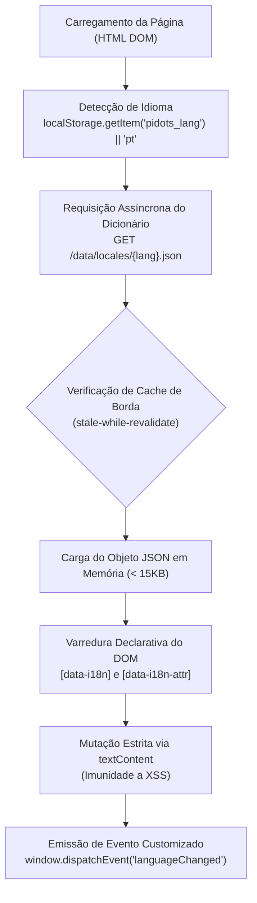

#### Contrato Declarativo de Atributos HTML
O micro-motor realiza a varredura e mutação segura do DOM através de atributos semânticos:

| Atributo DOM | Mecanismo de Atualização | Exemplo de Uso |
| :--- | :--- | :--- |
| `data-i18n="chave"` | Mutação estrita de texto via `node.textContent` | `<span data-i18n="nav.overview">VISÃO GERAL</span>` |
| `data-i18n-placeholder="chave"` | Atualização segura do atributo `placeholder` | `<input data-i18n-placeholder="guide.search_placeholder" />` |
| `data-i18n-title="chave"` | Atualização do atributo `title` de acessibilidade | `<button data-i18n-title="telemetry.node_title">...</button>` |
| `data-i18n-attr="attr:chave"` | Mapeamento genérico de atributos HTML | `<button data-i18n-attr="aria-label:nav.manual">...</button>` |

#### Proteções de Borda e Resiliência
1. **Imunidade a XSS:** Toda mutação textual utiliza exclusivamente `textContent`, prevenindo qualquer injeção de HTML arbitrário ou execução não autorizada de scripts provindos de traduções.
2. **Cache HTTP Calibrado:** O endpoint `/data/locales/{lang}.json` responde com `Cache-Control: public, max-age=3600, stale-while-revalidate=86400`, eliminando requisições repetidas ao disco MicroSD.
3. **Fallback Dinâmico e Preservação de Tags:** Elementos complexos com formatações filhas (como quebras de linha `<br>` ou badges internos) utilizam spans desacoplados para que a substituição de texto preserve a integridade visual da árvore DOM.

### 12.6 Arquitetura do Protocolo de Slash Commands (/) e Despacho de Borda

O Console Operacional incorpora um motor léxico e despachador assíncrono de comandos iniciados por barra (`/`) projetado sob os seguintes pilares técnicos:

```
+--------------------------------------------------------------------------+
|                 FLUXO ARQUITETURAL DE SLASH COMMANDS                     |
+--------------------------------------------------------------------------+
|                                                                          |
|  [Input: #instructionInput] (Digita '/') OU [Botao Touch: #slashTriggerBtn]
|             |                                                            |
|             +--> [SlashCommandsEngine] (Fuzzy Filter in-memory < 10KB)    |
|             |          |                                                 |
|             |          v                                                 |
|             |    Popover Flutuante (7 Abas de Filtro, Setas, Tab/Enter)  |
|             |                                                            |
|             v                                                            |
|  [Submit: transmitInstruction()]                                         |
|             |                                                            |
|             +-- [Prompt comeca com '/']?                                 |
|             |          |                                                 |
|             |        [SIM]                                               |
|             |          v                                                 |
|             |   [executeSlashCommand(cmdLine)]                           |
|             |          |                                                 |
|             |          +-- Match no catalogo de 30 comandos?             |
|             |          |         |                                       |
|             |        [SIM]     [NAO] -> findClosestCommand (Levenshtein) |
|             |          |                                                 |
|             |          v                                                 |
|             |   Execucao Local (< 16ms) / REST Endpoint Direto           |
|             |          |                                                 |
|             |          v                                                 |
|             |   renderSlashReceiptSlip()                                 |
|             |   (Recibo Tatil, SEQ#, Timestamp ISO, Picote Serrilhado)   |
|             |   enforceDomCeiling() -> Teto estrito de 150 nos DOM       |
|             |                                                            |
|             |                                                            |
|           [NAO]                                                          |
|             v                                                            |
|  Fluxo Padrao LLM / SSE (/api/threads/{id}/runs)                         |
+--------------------------------------------------------------------------+
```

1. **Interceptação no Cliente (< 16ms):** Comandos locais não realizam chamadas a provedores de LLM, o que elimina latência de rede e consumo de tokens para inspeção de telemetria, configuração de interface e gerenciamento de sessão.
2. **Buffer Circular de DOM (150 Nós):** A função `renderSlashReceiptSlip` integra-se a `enforceDomCeiling`, garantindo que recibos antigos sejam purgados do DOM de forma FIFO estrita para manter a pegada de memória RAM estável em hardware restrito.
3. **Tolerância a Falhas com Levenshtein:** Algoritmo de distância de edição com limite `max_distance <= 3` integrado, sugerindo correções imediatas quando erros tipográficos ocorrem.
4. **Isolamento de Escopo e XSS:** Todo texto dinâmico e parâmetro fornecido pelo operador passa por `escapeHtml()` antes da montagem estrutural dos recibos.

### 12.7 Tríptico Adaptativo do Workspace (1024px-1440px) e Telemetria Edge Pulse

Para solucionar a compressão lateral de interface em notebooks de resoluções médias (1024px a 1440px), o Workspace adota uma topologia adaptativa de 3 colunas:
1. **Colapso Sob Demanda da Barra Lateral:** Em telas entre 1024px e 1440px, a coluna esquerda (canais e Dots) colapsa automaticamente, funcionando como gaveta flutuante sob demanda de 260px com camada de fundo acionada via `Alt+B` ou clique no botão `[PAINEL]`. Isso eleva a largura útil do teletipo de 202px para mais de 750px, mantendo o Live Canvas aberto lado a lado sem espremer a leitura do operador.
2. **Edge Pulse Chip de Telemetria:** Substitui a multiplicidade de chips dispersos no cabeçalho por uma pílula técnica única de alta densidade (`[EDGE // 48.2 °C // 118 MB // WAL ATIVO // HITL 0]`), economizando mais de 360px de espaço horizontal no topo da tela.
3. **Canvas Responsivo com Split Dinâmico:** O editor de documentos Spaces ajusta sua largura em proporção 50/50 em desktops e pode ser expandido em tela cheia com a tecla `F11`.

### 12.8 Arquitetura Frontend Modular Desacoplada e EdgeAssetManager

A versão 1.5.0 do piDots consolidou o desacoplamento completo dos grandes monólitos de frontend, decompondo os documentos em camadas independentes de alta coesão e baixo acoplamento:

```
frontend/
├── pages/                           # Documentos HTML semânticos enxutos
│   ├── app.html                     # Console operacional Workspace (/app) — redução de 86%
│   ├── landing.html                 # Landing page oficial de apresentação (/) — redução de 59%
│   ├── docs.html                    # Guia didático e manual de referência (/docs) — redução de 51%
│   └── relatorio.html               # Relatório histórico de engenharia (/relatorio)
├── static/
│   ├── css/                         # Folhas de estilo modulares segmentadas
│   │   ├── tokens.css               # Design tokens, cores Noir/Blueprint e insets
│   │   ├── reset.css                # Resets de caixa, tipografia e teletipo scrollbars
│   │   ├── layout.css               # Casca tríptica, header e barra de telemetria
│   │   ├── components.css           # Botões chanfrados, inputs, carimbos e catálogos SVG
│   │   ├── mobile.css               # Ergonomia touch, safe areas e prevenção de zoom
│   │   ├── spa.css                  # Estilos específicos do Console Workspace
│   │   ├── landing.css              # Estilos do Hero, calculadora ROI e ReAct simulator
│   │   ├── docs.css                 # Estilos do Guia Didático e blocos de código
│   │   └── relatorio.css            # Estilos dedicados do relatório de engenharia
│   └── js/                          # Motores JavaScript desacoplados em Vanilla JS
│       ├── core/                    # pidots-i18n.js, scroll-lock.js, pixel-system.js
│       ├── spa/                     # pidots-api.js, slash-commands.js, tour-engine.js, pidots-ux.js, app-init.js
│       ├── landing/                 # landing.js (simuladores e calculadora)
│       └── docs/                    # docs.js (Omnisearch Ctrl+K e mini API tester)
```

#### Princípios de Engenharia da Camada Desacoplada:
1. **Zero-Build e Vanilla JS Puro:** Não utiliza ferramentas de empacotamento pesadas no nó de silício (Node.js/Webpack/Vite), o que elimina consumo de memória RAM em segundo plano e preserva o hardware ARM64 do Raspberry Pi 4B.
2. **Encapsulamento IIFE com Exportação Global:** Todos os módulos JavaScript são estruturados com escopo fechado via IIFE e exportação seletiva para o objeto `window`, mantendo total compatibilidade com manipuladores de eventos declarativos (`onclick`, `onkeydown`).
3. **`EdgeAssetManager` In-Memory Preload:** Todas as páginas HTML são pré-carregadas na memória RAM durante a inicialização da aplicação FastAPI (`lifespan`), recebendo hash ETag SHA-256 e versão pré-comprimida em Gzip. Leituras consecutivas no cartão MicroSD são zeradas.
4. **Cache HTTP Condicional (ETag / HTTP 304):** As respostas validam o cabeçalho `If-None-Match` e devolvem `304 Not Modified` com 0 bytes de carga para clientes locais ou sob conexões em túnel.
5. **Service Worker v7 (`pidots-cache-v7`):** Atualização da esteira de cache offline do navegador com suporte integral aos 9 arquivos CSS e 11 arquivos JS modularizados, o que mantém a operação contínua mesmo sem acesso à rede.

---

## 13. Camada de Cabeçalhos de Segurança HTTP e Hardening de Rede de Borda

Para proteger a estação de trabalho de borda exposta na rede local ou em túneis remotos (Cloudflared/Tailscale), a aplicação FastAPI injeta cabeçalhos defensivos de segurança em todas as respostas HTTP processadas pelo middleware assíncrono:
1. **`X-Content-Type-Options: nosniff`:** Impede que navegadores adivinhem tipos MIME em artefatos, respostas textuais ou scripts servidos, o que fecha vetores de exploração estática.
2. **`X-Frame-Options: SAMEORIGIN`:** Impede que domínios externos incorporem o console operacional SPA, o guia ou a landing page dentro de frames externos para bloquear ataques de clickjacking.
3. **`Referrer-Policy: strict-origin-when-cross-origin`:** Garante que dados de contexto, caminhos internos de rotas ou parâmetros de busca não vazem para serviços externos ao navegar a partir da aplicação.

---

## 14. Arquitetura de Resiliência Cognitiva, Circuit Breaker e Contratos AG-UI v1.0

A operação autônoma contínua 24/7 em hardware de borda (Raspberry Pi 4B) impõe que falhas de rede, oscilações de latência, limites de taxa ou credenciais inválidas no provedor remoto de LLM sejam tratadas de forma determinística, sem travar o loop de eventos, sem corromper o estado do banco e sem gerar falsos positivos operacionais.

### 14.1 Hierarquia de Exceções Tipadas e Short-Circuit

O módulo `pidots/providers/openai_client.py` define uma taxonomia clara para diferenciar falhas recuperáveis de irrecuperáveis:

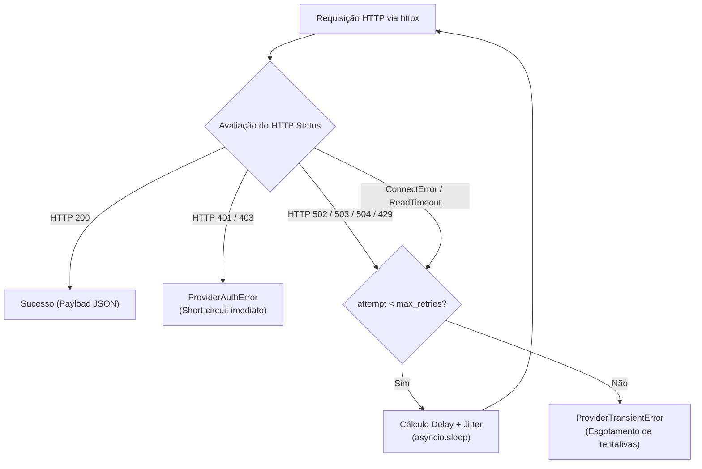

1. **`ProviderAuthError` (Irrecuperável):** Disparado em respostas HTTP 401 (Unauthorized) ou HTTP 403 (Forbidden). Aplica **short-circuit imediato**, o que encerra o ciclo ReAct sem retentativas inúteis que sobrecarregariam a CPU e consumiriam banda de rede.
2. **`ProviderTransientError` (Recuperável com Backoff):** Disparado em erros transitórios HTTP 503 (Service Unavailable), HTTP 429 (Rate Limit), HTTP 502/504 ou falhas de conexão/tempo esgotado de rede (`ConnectError`, `ReadTimeout`). Executa retentativas controladas com backoff exponencial e jitter pseudo-aleatório (`delays = [1.0, 2.0, 4.0] + random.uniform(0.1, 0.5)`). Caso as tentativas se esgotem, levanta `ProviderTransientError`.

### 14.2 Padronização do Contrato AG-UI v1.0 e Registro Interno de Diagnóstico

Durante a execução de `DotAgent.run_thread()`, o ciclo ReAct assegura que falhas de inferência emitam eventos estruturados e mensagens de rastreabilidade:

1. **Emissão Padronizada de `run:finished`:**
   Ao capturar `ProviderAuthError` ou `ProviderTransientError`, o gerador assíncrono emite:
   ```json
   {
     "event": "run:finished",
     "data": {
       "run_id": "uuid-da-execucao",
       "status": "failed",
       "final_response": "",
       "error": "Descrição técnica da falha",
       "error_type": "auth_error"
     }
   }
   ```
2. **Registro Interno de Diagnóstico:**
   Antes de emitir o encerramento da thread, o agente grava uma mensagem de diagnóstico no SQLite WAL com o campo `visibility = 'internal'`:
   - Conteúdo: `[FALHA DE AUTENTICAÇÃO]: ...` ou `[FALHA DE INFERÊNCIA]: ...`.
   - O registro permite auditoria técnica completa via console administrativo ou CLI, sem poluir o feed principal do usuário.

### 14.3 Resiliência dos Três Consumidores Arquiteturais

Os três componentes que orquestram a execução do `DotAgent` consomem o evento `run:finished` com tratamento defensivo especializado:

| Consumidor | Módulo | Comportamento em Falha (`status == 'failed'`) | Impacto Arquitetural |
| :--- | :--- | :--- | :--- |
| **EdgeScheduler** | `pidots/core/scheduler.py` | Marca `last_status = 'FAILED'`, persiste sumário real do erro em `last_result_summary` e aciona o cálculo de backoff. | Elimina falsos positivos de `COMPLETED` em tarefas cron. |
| **MessagingGateway** | `pidots/core/messaging_gateway.py` | Detecta falha e despacha aviso técnico `[FALHA OPERACIONAL]: O agente encontrou uma falha de conexão...` para o Telegram, WhatsApp ou webhook. | Evita silêncio operacional ou mensagens vazias enviadas aos canais externos. |
| **MultiBotOrchestrator** | `pidots/core/orchestrator.py` | Atualiza o registro em `agent_handoffs` para `status = 'FAILED'`, emite alerta interno `[FALHA NA SUBTAREFA DE @dot]` na thread principal e retorna `{'success': False, 'error': ...}`. | Notifica o supervisor programaticamente, o que permite replanejamento sem travar a thread. |

### 14.4 Máquina de Estados do Circuit Breaker em Tarefas Proativas

Para impedir tempestades de reconexão (*retry storms*) em falhas contínuas de infraestrutura ou chaves expiradas, o escalonador `EdgeScheduler` implementa um Circuit Breaker com as seguintes regras de transição:


1. **Cálculo do Backoff Exponencial:**
   Em cada falha consecutiva, o retardo de backoff é calculado determinística e progressivamente através de `min(3600, 30 * 2^(n-1))`:
   - Falha 1: 30 segundos
   - Falha 2: 60 segundos
   - Falha 3: 120 segundos
   - Falha 4: 240 segundos
   - O campo `backoff_until` é atualizado no SQLite WAL para bloquear execuções antes do prazo.
2. **Abertura do Circuito (`CIRCUIT_OPEN`):**
   Na 5ª falha consecutiva, o circuito abre. O registro recebe `last_status = 'CIRCUIT_OPEN'` e `is_active = 0`. A tarefa é desativada de forma segura até intervenção manual do operador.
3. **Verificação Preventiva de Chaves (`AUTH_REQUIRED`):**
   Antes de instanciar o agente, o escalonador verifica se a credencial do provedor é uma string vazia ou placeholder (`sua_chave_aqui`, `placeholder`). Se detectada, a tarefa recebe `last_status = 'AUTH_REQUIRED'`, `backoff_until = now + 10min` e não realiza nenhuma chamada externa, o que preserva energia e ciclos de rede do Raspberry Pi.

### 14.5 Gateway Multi-Provedor com Circuit Breaker de 3 Estados (CLOSED, OPEN, HALF_OPEN)

O cliente universal de inferência (`pidots/providers/openai_client.py`) implementa um Circuit Breaker de nível de transporte que desacopla o provedor primário do provedor secundário de failover:

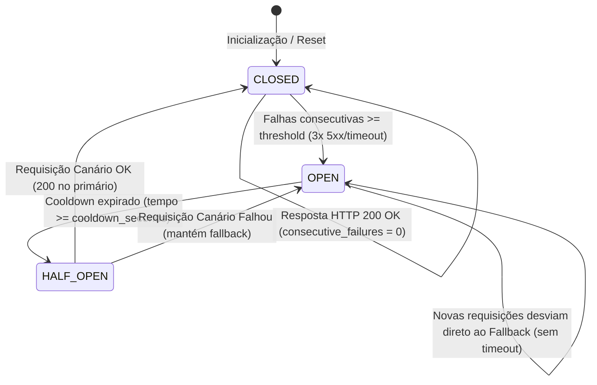

1. **Estado `CLOSED` (Operação Nominal):**
   - Requisições são direcionadas ao endpoint primário (`AI_BASE_URL`).
   - Retentativas com backoff exponencial e jitter (`delays = [1.5, 3.5, 7.0]`) absorvem instabilidades transitórias.
   - Em caso de falha persistente: se `AI_FALLBACK_URL` estiver configurada, o failover secundário é acionado transparentemente sem erro para o agente, e o contador `consecutive_failures` é incrementado.
2. **Estado `OPEN` (Isolamento de Falha Contínua):**
   - Ao atingir o limiar consecutivo de falhas (padrão: 3 falhas), o circuito primário abre.
   - Durante o período de cooldown (padrão: 60 segundos), nenhuma requisição é enviada ao primário; as chamadas são despachadas imediatamente para o provedor secundário de failover, o que remove o atraso de timeouts sucessivos no Raspberry Pi 4B.
3. **Estado `HALF_OPEN` (Teste Canário de Auto-Recuperação):**
   - Após o término do cooldown, a próxima chamada de inferência executa um teste canário no provedor primário.
   - Se o primário responder com 200 OK, o circuito retorna a `CLOSED` e `consecutive_failures` é zerado. Se falhar, o circuito retorna a `OPEN` por mais um ciclo de cooldown e a requisição é atendida pelo fallback.
4. **Comportamento Inócuo:**
   - Se nenhuma `AI_FALLBACK_URL` estiver configurada, o sistema mantém o comportamento estritamente nominal e inócuo, preservando a escolha do operador que não utiliza provedores secundários.

---

## 15. Subsistema de Memória Hierárquica Autônoma (MemGPT / Letta)

Para superar a amnésia sem sobrecarregar a janela de contexto, o módulo `pidots/storage/memory_manager.py` implementa uma arquitetura de memória em 3 camadas inspirada no MemGPT/Letta:

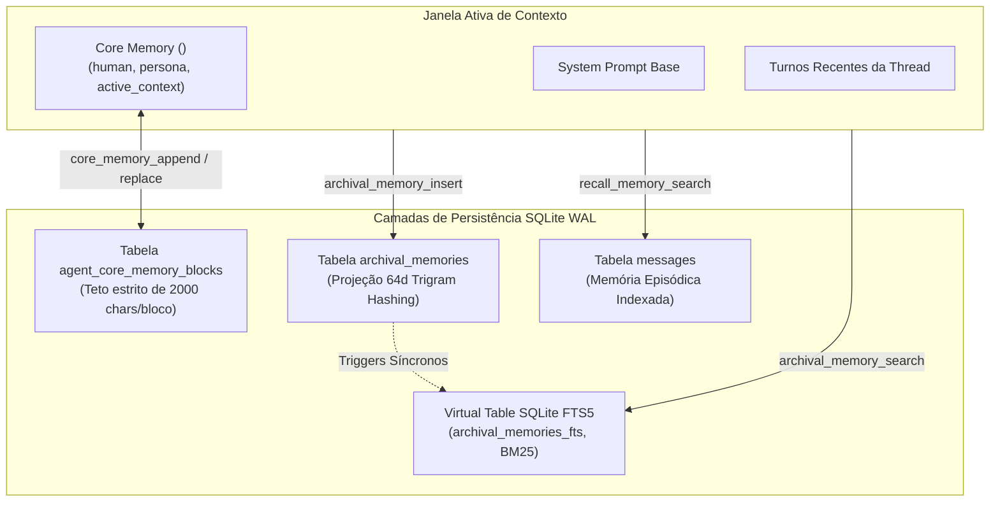

1. **Core Memory In-Context:**
   - Injetada diretamente no system prompt sob o bloco XML `<core_memory>`.
   - Limite estrito por bloco (`max_chars = 2000`) para evitar extrapolação de tokens.
   - Ferramentas nativas `core_memory_append` e `core_memory_replace` que o próprio agente executa quando aprende preferências do usuário ou atualiza seu foco operacional.
2. **Archival Memory com Busca Híbrida BM25 + 64d e Deduplicação Semântica:**
   - Base duradoura de fatos e documentações indexada na Virtual Table `archival_memories_fts` via triggers SQL nativos (`trg_archival_insert`, `trg_archival_update`, `trg_archival_delete`).
   - Algoritmo de projeção esparsa `compute_compact_embedding`: calcula um vetor de 64 dimensões combinando hash de trigramas (3-grams) e ativação semântica pura em CPU, com pontuação híbrida `score = abs(rank) + similaridade * 0.5`.
   - **Deduplicação Semântica (> 0.92):** Avaliação de similaridade por cosseno antes da gravação. Se existir fato equivalente com similaridade `>= 0.92`, executa merge/update atômico de tags e conteúdo sem duplicar linhas no SQLite WAL nem inflar a tabela virtual FTS5.
3. **Recall Memory:**
   - Ferramenta `recall_memory_search` que consulta turnos e decisões anteriores da conversa diretamente na tabela `messages`.

---

## 16. Subsistema de Self-Healing Harness e Planejamento em Dois Estágios

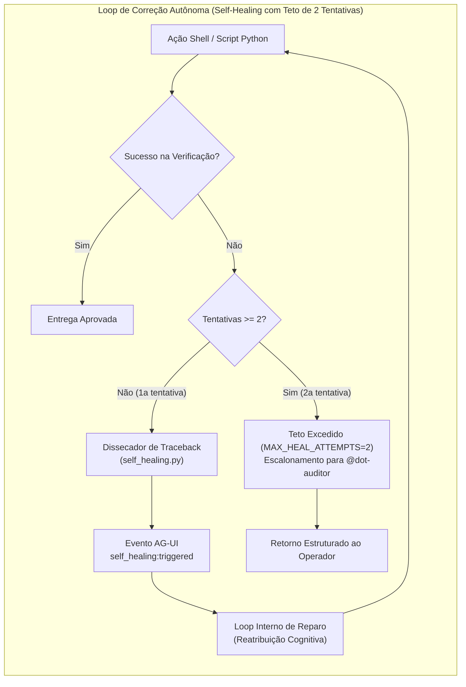

1. **Self-Healing Harness (`pidots/core/self_healing.py`):**
   - Ferramenta `execute_and_verify`: exige um comando principal e um comando de verificação (ex: `pytest` ou `python3 -m py_compile`).
   - Em caso de código de saída diferente de zero ou presença de traceback, o analisador isola o arquivo, linha e nome da exceção, devolvendo recomendação técnica direta de correção para o agente.
   - **Teto Estrito de 2 Tentativas (`MAX_HEAL_ATTEMPTS = 2`):** Caso o erro persista na segunda tentativa de reparo, o ciclo é imediatamente interrompido, emitindo `self_healing:max_attempts_exceeded` e escalando o traceback ao `@dot-auditor` para evitar loops infinitos de tokens.
2. **Planejamento em Dois Estágios (`pidots/core/planner.py`):**
   - Tabela `goals` (metas gerais) e tabela `milestones` (marcos ordenados).
   - O agente cria o plano com `plan_create`, avança etapas com `plan_update_step` ao anexar evidências técnicas (`evidence_summary`), e consulta o progresso com `plan_get_status`.
   - O progresso percentual é recalculado atomicamente e injetado no prompt sob `<execution_plan>`.

---

## 17. Conselho Consultivo e Deliberação Dialética Multi-Bot

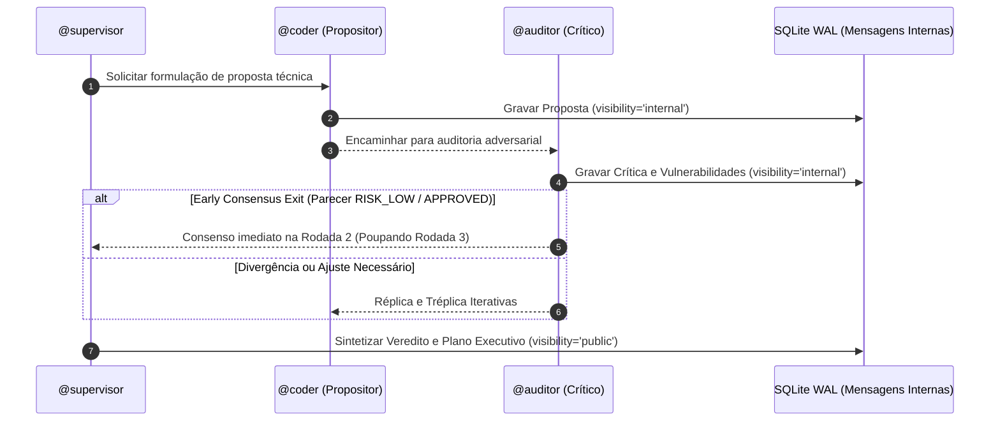

- **Papéis Estritos:** Propositor formula o código ou arquitetura; Crítico aponta brechas de segurança, concorrência e consumo de memória; Supervisor sintetiza a versão definitiva.
- **Mensagens Internas:** As mensagens intermediárias do debate têm `visibility = 'internal'` para manter o feed público conciso.
- **Resolução Pública:** O veredito executivo é gravado com cabeçalho formal `[CONSELHO CONSULTIVO - RESOLUÇÃO FINAL]` e `visibility = 'public'`.
- **Early Consensus Exit:** Se na Rodada 2 do debate tripartite o `@dot-auditor` classificar a proposta do `@dot-coder` como `RISK_LOW / APPROVED`, o orquestrador consolida a decisão antecipadamente (`early_consensus = True`), o que dispensa a terceira rodada e economiza tokens de inferência na borda.
- **Contenção de Hardware:** Trava rígida de no máximo 3 rodadas (`MAX_COUNCIL_ROUNDS = 3`), operando com consumo estritamente inferior a 53 MB de RAM.

---

## 18. Shared Knowledge Space e Templates Dot Packs v1.0

1. **Shared Knowledge Space (`pidots/storage/shared_space.py`):**
   - Quadro colaborativo indexado por `(thread_id, topic_key)` na tabela `thread_shared_notes`.
   - Permite que múltiplos agentes gravem notas técnicas com `shared_space_write` e consultem com `shared_space_read`.
   - O conteúdo é compilado no bloco XML `<shared_knowledge_space>` e entregue a todos os interlocutores da conversa.
2. **Dot Packs v1.1 (`pidots/core/dot_pack.py`):**
   - Manifesto padronizado JSON contendo persona, arquétipo, ferramentas, blocos de Core Memory, memórias arquivísticas, snapshot de arquivos e assinatura criptográfica `sha256_checksum`.
   - Endpoints REST: `GET /api/dots/{dot_id}/export-pack` para geração do manifesto assinado e `POST /api/dots/import-pack` para validação de integridade, inspeção contra Prompt Injection e instanciação atômica de novos agentes em qualquer Raspberry Pi.

---

## 19. Gatilhos de Hardware de Borda e Manutenção Noturna do MicroSD

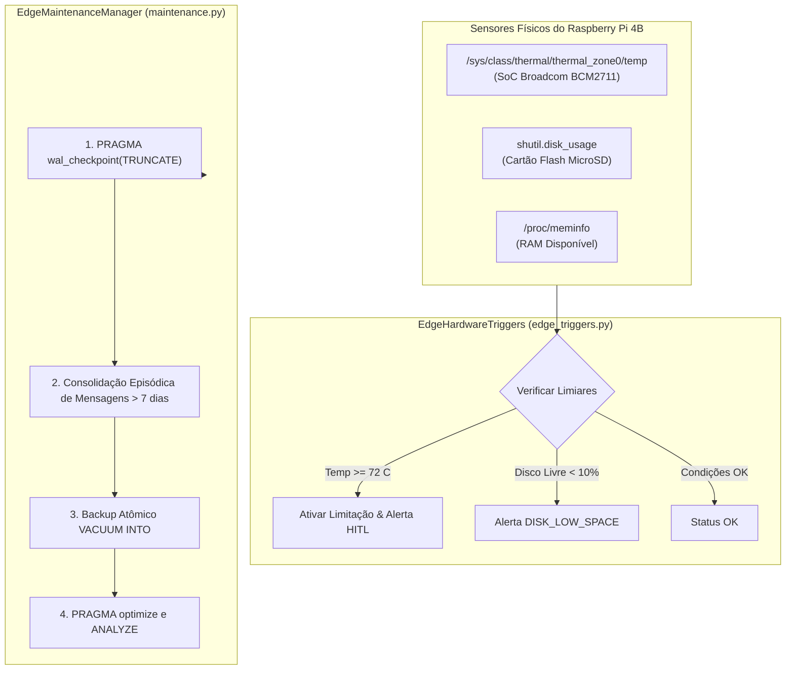

1. **Gatilhos de Hardware Orientados a Eventos (`pidots/core/edge_triggers.py`):**
   - Leitura direta via sysfs de `/sys/class/thermal/thermal_zone0/temp`.
   - Avaliação a cada ~60s no loop proativo do `scheduler.py` ou sob demanda via `hardware_trigger_check` e rota `GET /api/edge/triggers`.
   - Se a temperatura atingir SoC >= 72 °C (`settings.thermal_limit_celsius`), o sistema classifica o evento como `WARNING` ou `CRITICAL` (SoC >= 78 °C) e despacha alerta HITL imediato ao operador.
2. **Preservação Rigorosa do MicroSD (`pidots/storage/maintenance.py`):**
   - `PRAGMA wal_checkpoint(TRUNCATE)` sincroniza e esvazia o arquivo `-wal`, prevenindo desgaste de células flash.
   - Consolida mensagens antigas (> 7 dias) na tabela `episodic_memories` e remove mensagens brutas para economizar blocos de armazenamento.
   - Executa `VACUUM INTO` em conexão isolada com autocommit (`isolation_level=None`), gerando cópias de segurança sem bloqueio concorrente.
   - Endpoint: `POST /api/edge/maintenance`.

---

## 20. Motor de Tour Spotlight Interativo e Experiência de Primeiro Acesso (PiDotsTourEngine)

O **PiDotsTourEngine** é o módulo client-side em Vanilla JS puro (< 12KB) responsável por guiar novos operadores pelo cockpit do piDots em seus primeiros acessos, eliminando modais estáticos ineficientes e adotando o padrão de **Spotlight Walkthrough in-context**.

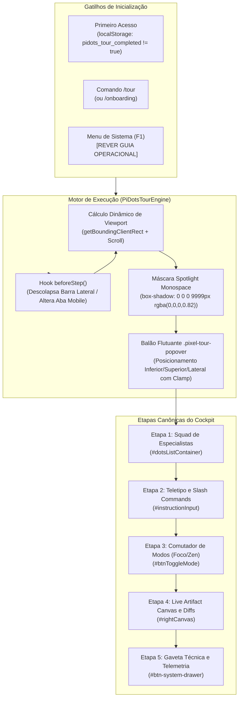

### Princípios de Engenharia do PiDotsTourEngine:
1. **Zero Dependências Pesadas:** Nenhuma biblioteca de terceiros (como Intro.js ou Shepherd.js). Implementado diretamente em propriedades customizadas CSS e DOM API padrão, preservando RAM e processamento no cliente.
2. **Preparação Reativa do DOM (`beforeStep`):** Se um painel estiver recolhido (como o Live Canvas ou a barra lateral), o motor executa automaticamente a transição de abertura antes de focar o elemento, recalculando coordenadas após a animação.
3. **Persistência Local Segura:** Utiliza `localStorage.getItem('pidots_tour_completed')`. O operador pode reiniciar o fluxo a qualquer momento com o comando `/tour reset`.

---

## 21. Extensibilidade MCP Lite, Governança Criptográfica e Barramento Físico de Borda (v1.5.3)

A versão 1.5.3 consolida as novas capacidades operacionais de extensão e segurança física do piDots:

### 21.1 Cliente MCP Lite (< 5MB RAM, STDIO/SSE, Dynamic Tool Pruning)
- **Protocolo:** JSON-RPC 2.0 sobre transporte STDIO (via `asyncio.create_subprocess_exec`) e SSE/HTTP (via `httpx.AsyncClient`).
- **Conversão para OpenAI:** Ferramentas retornadas por `tools/list` são convertidas para a especificação da OpenAI API com prefixo `mcp_{server}_{tool}`.
- **Poda Dinâmica (Tool Pruning):** O catálogo de ferramentas MCP registradas passa compulsoriamente pelo filtro `allowed_tools_json` de cada Dot, garantindo que agentes sem a permissão explícita não recebam ferramentas externas na carga de inferência.

### 21.2 Governança HITL Interativa via Telegram e WhatsApp com Assinatura HMAC-SHA256
- **Assinatura HMAC:** Todo alerta de ação crítica retida gera tokens de aprovação e bloqueio assinados com chave secreta (`settings.hitl_hmac_secret`).
- **Telegram Inline Keyboard:** Notificações despachadas ao bot do Telegram incluem botões interativos `[Aprovar]` e `[Bloquear]` com callback data compacto assinado (`h:a:<id>:<hmac>`), cabendo com folga no teto de 64 bytes da API.
- **Validação em Tempo Constante:** A rota `/api/hitl/signed-resolve` e os webhooks validam a autenticidade usando `hmac.compare_digest` antes de autorizar a execução da operação.

### 21.3 Dot Packs v1.1 com Assinatura Criptográfica SHA-256 e Defesa contra Injeção de Prompt
- **Integridade Criptográfica:** Manifestos exportados contêm o campo `sha256_checksum` cobrindo o conteúdo canônico do agente, blocos de Core Memory e memórias arquivísticas. Na importação, divergências no hash provocam recusa imediata.
- **Inspeção Defensiva pelo @dot-auditor:** O motor inspeciona `system_prompt`, `core_memory` e memórias arquivísticas contra padrões maliciosos de injeção de prompt (ex: `ignore previous instructions`, `system override`, `exfiltrate keys`), recusando o pacote caso ameaças sejam detectadas.

### 21.4 Barramento Físico GPIO e Gatilhos de Borda MQTT
- **Monitoramento de Hardware:** Leitura de pinos GPIO (via sysfs ou libgpiod) com disparos orientados a eventos (ex: botão físico de emergência no pino 17 com severidade `CRITICAL`).
- **Listener MQTT Assíncrono:** Receptor assíncrono de telemetria de sensores locais conectado a rotinas do `EdgeScheduler` sem degradar o loop uvloop do FastAPI.

---

## 22. Padrão OpenDots e Protocolo CopilotKit CoAgents / AG-UI (v1.5.3)

A versão 1.5.3 integra os paradigmas do projeto **CopilotKit/OpenDots** e do protocolo **AG-UI / CoAgents** diretamente no monólito modular do piDots e na estética **Pixel Paper UI** do console `/app`:

### 22.1 Activity Rail Lateral e 4 Painéis Contextuais
- **Activity Rail (48px):** Barra vertical esquerda inspirada no padrão OpenDots, permitindo alternância instantânea entre 4 painéis operacionais sem recarregar a página:
  1. `[SPACES]`: Canais multi-bot (`#channel`), tópicos em árvore (`threads`) e documentos versionados (`Spaces`) com busca em tempo real.
  2. `[DOTS]`: Squad de agentes especialistas com criação e edição ao vivo via modal `#pixelDotCreatorModal` e matriz visual de *Dynamic Tool Pruning* (`allowed_tools_json`).
  3. `[TASKS]`: Rotinas autônomas agendadas (Cron / Heartbeat) com disparo imediato (`POST /api/tasks/{id}/run`) e alternância ativo/pausado (`PATCH /api/tasks/{id}/toggle`).
  4. `[MEM/MCP]`: Busca Híbrida RRF (FTS5 BM25 + Vetor 64D) e gerenciamento de servidores MCP Lite (`GET/POST /api/edge/mcp/servers`).

### 22.2 Generative UI Inline e HITL com Edição de Argumentos (`modified_args`)
- **Generative UI Cards (`.gen-ui-card`):** Eventos SSE do protocolo AG-UI (`tool_call:start`, `tool_call:result`, `artifact:updated`) são renderizados como fichas catalográficas colapsáveis diretamente na fita do teletipo, exibindo status `[EXECUTANDO...]`, tempo de execução em milissegundos e carga útil formatada.
- **Interrupt-Resume com `modified_args`:** Quando a governança HITL retém uma ação crítica, o operador pode editar os argumentos JSON no cartão inline ou na janela HITL e enviar `modified_args` para `POST /api/hitl/{id}/resolve`. O motor `DotAgent.resume_after_hitl()` injeta os argumentos corrigidos e retoma o loop ReAct sem perder o contexto da conversa.

### 22.3 CoAgents Shared State (`STATE_SNAPSHOT` e `STATE_DELTA`) e Computador do Dot
- **Estado Compartilhado Bidirecional:** O motor emite `state:snapshot` no início de cada turno e `state:delta` a cada transição de nó cognitivo (`router -> thinker -> tool_executor -> verifier -> responder`), sincronizando a aba `[COAGENTS]` em tempo real e aceitando sobreposições manuais via `PATCH /api/threads/{id}/state`.
- **Computador do Dot (`Dot's Computer`) e Modo Takeover:** O painel direito unifica terminal sandbox (`POST /api/edge/computer/exec`), navegador de arquivos de workspace (`GET /api/edge/computer/files`), editor de artefatos, CoAgents State e telemetria térmica, contando com **Modo Takeover** para execução manual direta pelo operador humano.

---

## 23. Desoneração de Assets via Nginx Alpine Multi-Porta & Catálogo de Dot Packs (v1.5.4)

### 23.1 Nginx Alpine como Proxy Reverso de Borda Multi-Porta
- **Topologia Desacoplada:** O serviço `pidots-nginx` (`nginx:1.27-alpine`) roda em contêiner de menos de 6MB de memória RAM, escutando simultaneamente nas portas `8081` (Landing), `8082` (Workspace), `8083` (Docs) e `8088` (Gateway Unificado), servindo `/static/` e `/data/locales/` com cabeçalho `Cache-Control: public, max-age=31536000, immutable`.
- **Streaming SSE e WebSockets:** Configurado com `proxy_buffering off` e headers de upgrade para evitar retenção de buffers e latência em eventos de streaming `text/event-stream`.
- **FastAPI Dedicado:** O processo Uvicorn na porta 8000 dedica 100% dos ciclos de CPU do Broadcom BCM2711 para o motor ReAct, inferência e operações no SQLite WAL.

### 23.2 Catálogo Comunitário de 3 Dot Packs Oficiais Assinados
- **Manifestos Padronizados em `data/packs/`:**
  1. `dot-secops.json` (SHA-256: `29bf745599...`): Especialista em auditoria e hardening.
  2. `dot-homelab.json` (SHA-256: `a343aa2712...`): Orquestrador de infraestrutura local e sensores.
  3. `dot-finops.json` (SHA-256: `2f0732e1c7...`): Analista de telemetria e custos energéticos.
- **Instalação em 1 Clique:** Endpoint `POST /api/dots/packs/install/{pack_id}` realiza a checagem criptográfica em tempo constante e instancia o Dot com Core Memory e memórias arquivísticas de forma atômica no banco WAL.

---

## 24. Engenharia Centauro & Governança de Hardware Físico

### 24.1 Manifesto de Engenharia Centauro (`AI_MANIFESTO.md`)
O projeto adota o compromisso formal de coautoria humano-máquina, definindo:
- **Restrições Reais de Silício:** Limite térmico de 78°C para o SoC Broadcom BCM2711, proteção contra exaustão de ciclos Flash MicroSD com checkpoints periódicos e uso de no máximo 384MB de RAM RSS em nós de 4GB.
- **Padrão Estético Funcional:** Interface táctil inspirada em teletipos e relatórios industriais, sem emojis ou abstrações desnecessárias.

### 24.2 CI/CD Multi-Plataforma
O fluxo de automação do repositório compila imagens Docker simultaneamente para as arquiteturas `linux/amd64` e `linux/arm64` via emuladores QEMU e construtores Docker Buildx, validando a integridade das 22 baterias de testes em cada versão lançada.

---

## 25. Arquitetura Visual OpenDots Spatial & Pixel Paper UI (v1.5.5)

### 25.1 Top Deck Canônico de 48px
- **Padronização Geométrica:** Todas as superfícies do sistema (`/`, `/app`, `/docs`, `/relatorio`) utilizam o container semântico unificado `header.top-deck` com altura rígida de 48px (`--header-height: 48px`) e alinhamento triplo:
  - `.top-deck-left`: Marca `piDots`, indicador de nó online e gatilho de gaveta.
  - `.top-deck-center`: Comutador de superfícies com atalhos de teclado sequenciais (`g h`, `g w`, `g d`).
  - `.top-deck-right`: Ações utilitárias (pesquisa, telemetria, idioma, tema escuro/claro e manual).
- **Desobstrução Mobile:** Em resoluções móveis (`< 1024px`), botões secundários são automaticamente recolhidos para a gaveta retrátil, eliminando o empilhamento de barras e preservando até 25% a mais de espaço vertical para a leitura.

### 25.2 Vitrine Developer-First na Landing Page (`/`)
- **Hero Split-Screen OpenDots:** A coluna esquerda apresenta a proposta de valor técnica calibrada para hardware restrito (52 MB RAM RSS, Broadcom BCM2711 ARM64), enquanto a coluna direita renderiza um simulador autêntico de bobina Pixel Paper UI com furos de trator (`.tractor-strip`) e ficha clicável de demonstração da governança HITL via HMAC-SHA256.
- **Bento Grid de Silício:** Quatro cartões modulares de alta densidade demonstram métricas de silício em tempo real: pegada de memória RAM, coordenação de especialistas com Tool Pruning, persistência relacional Flash-Safe em SQLite WAL e travas de recursão (`HOP <= 3`).

### 25.3 Governança Canônica de Guias e Documentação Técnica
- As rotas `/docs` e `/relatorio` atendem rigorosamente à diretriz arquitetural de guias didáticos:
  1. Menu lateral direito retrátil com gaveta e bloqueio de vazamento de rolagem (`ScrollLockManager`).
  2. Apresentação didática em estilo passo a passo com leitura progressiva orientada a artefatos.
  3. Mecanismo de busca rápida instantânea client-side com atalho global `Ctrl+K`.
  4. Diagramação responsiva em largura total (sem estreitamento centralizado artificial), otimizando a legibilidade de tabelas de endpoints e blocos de código com abas de sintaxe (Python, Bash, cURL, JSON).

---

## 26. Desacoplamento por Portas & Arquitetura Cloudflare Tunnel (v1.5.5)

### 26.1 Topologia de Superfícies Desacopladas
Para permitir a separação funcional de tráfego, isolamento de privilégios e publicação remota segura sem exposição de portas no roteador doméstico, o piDots v1.5.5 introduz a segregação por portas de borda:
- **Porta 8081 (Landing Page):** Superfície pública institucional, onboarding e simulador ReAct.
- **Porta 8082 (Console Workspace):** Interface SPA/PWA para operação de agentes autônomos, SSE AG-UI e WebSockets. Recomendada proteção via Cloudflare Zero Trust Access (2FA/IdP).
- **Porta 8083 (Documentação & Relatórios):** Guia didático passo a passo e estudos técnicos (`/relatorio`).
- **Porta 8088 (Gateway Unificado):** Ponto de entrada unificado path-based (`/`, `/app`, `/docs`) e redirecionamentos canônicos HTTP 308 (RFC 8594).
- **Porta 8000 (FastAPI Core):** Motor cognitivo assíncrono interno dedicado, sem exposição pública direta.

### 26.2 Arquitetura de Proxy Nginx Alpine Multi-Porta
O contêiner `pidots-nginx` (`nginx:1.27-alpine`) foi reestruturado para escutar simultaneamente em todas as portas de borda consumindo menos de 6MB de RAM total:
```mermaid
flowchart LR
    subgraph WAN["Internet / Acesso Remoto"]
        CF_Landing["pidots.dominio.com"]
        CF_App["app.dominio.com"]
        CF_Docs["docs.dominio.com"]
    end

    subgraph TunnelDaemon["Raspberry Pi 4B (cloudflared)"]
        CFTunnel["cloudflared daemon\n(QUIC Outbound)"]
    end

    subgraph NginxProxy["Nginx Alpine Multi-Porta (< 8MB RAM)"]
        P8081["Porta 8081\n(Landing)"]
        P8082["Porta 8082\n(App SPA)"]
        P8083["Porta 8083\n(Docs)"]
        P8088["Porta 8088\n(Gateway)"]
    end

    subgraph CoreBackend["FastAPI Core (Porta 8000)"]
        CoreAPI["FastAPI uvloop\n(ReAct + SQLite WAL)"]
    end

    CF_Landing --> CFTunnel
    CF_App --> CFTunnel
    CF_Docs --> CFTunnel

    CFTunnel -->|http://localhost:8081| P8081
    CFTunnel -->|http://localhost:8082| P8082
    CFTunnel -->|http://localhost:8083| P8083

    P8081 -->|/api/| CoreAPI
    P8082 -->|/api/ (SSE Buffering Off)| CoreAPI
    P8083 -->|/api/| CoreAPI
    P8088 --> CoreAPI
```

### 26.3 Roteamento Cruzado Inteligente (`CrossSurfaceRouter`)
O script `cross-surface-router.js` atua na camada do navegador identificando se a conexão provém de portas locais (`:8081`, `:8082`, `:8083`), de endereços IP de rede local ou de subdomínios Cloudflare (`app.*`, `docs.*`, `pidots.*`), reescrevendo os elementos de navegação e atalhos de teclado sequenciais (`g h`, `g w`, `g d`) para garantir alternância instantânea entre superfícies sem requisições 404.

