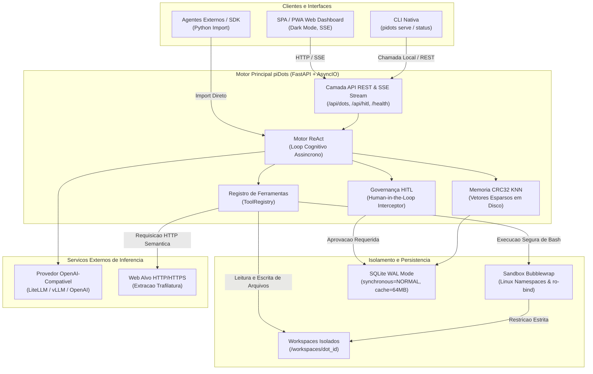
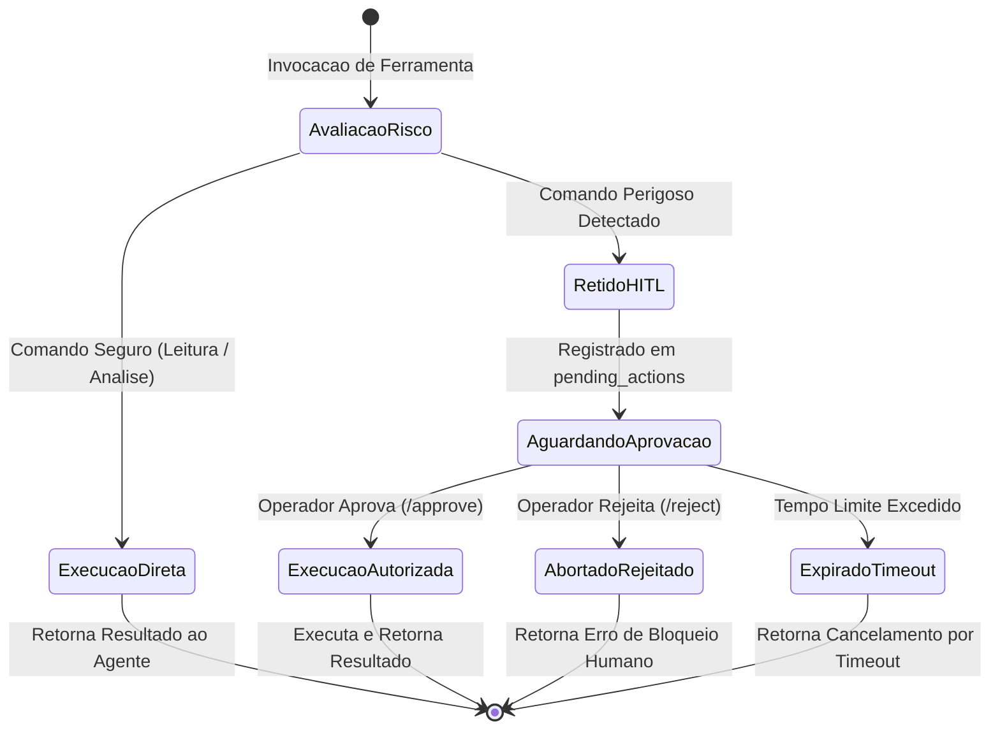

# Arquitetura e Engenharia de Software do piDots

Este documento detalha as decisoes de engenharia, padroes arquiteturais, modelos de concorrencia e otimizacoes de hardware adotadas no desenvolvimento do **piDots** para execucao persistente em ambientes com recursos estritamente limitados (Raspberry Pi 4B 4GB ARM64).

---

## 1. Visao Geral da Arquitetura

O piDots foi projetado sob o paradigma de **Monólito Modular Assincrono** (Single-Process, Event-Driven). Diferente de arquiteturas corporativas baseadas em microservicos orquestrados ou clusters de conteineres que demandam gigabytes de memoria apenas para overhead de rede e runtimes concorrentes, o piDots consolida todas as capacidades essenciais em um unico processo gerenciado pelo FastAPI e uvloop/AsyncIO.

### Diagrama de Blocos do Sistema



---

## 2. Ciclo de Vida Cognitivo ReAct e Intercepcao HITL

O agente executa o padrao ReAct (*Reasoning and Acting*) em streaming contínuo. Toda intencao de execucao de ferramenta passa por um analisador de risco deterministico antes da invocacao.

### Fluxo de Execucao Sequencial


---

## 3. Maquina de Estados da Governanca Human-in-the-Loop



---

## 4. Otimizacoes Extremas de I/O e SQLite para Edge (Cartao MicroSD / SSD)

O armazenamento em hardware como o Raspberry Pi 4B baseia-se em cartoes MicroSD (com barramento UHS-I de escrita sequencial lenta) ou discos SSD conectados via USB 3.0. Operacoes continuas de escrita com `fsync` sincrono destroem o desempenho de I/O e degradam prematuramente os blocos flash de memoria.

Para contornar este gargalo, a camada de banco de dados do piDots implementa o SQLite em modo **Write-Ahead Logging (WAL)** com as seguintes diretivas de baixo nivel:

```sql
-- Habilita escrita concorrente nao-bloqueante entre leitores e escritores
PRAGMA journal_mode = WAL;

-- Substitui fsync total por sync seguro apenas nos checkpoints do WAL
-- Evita pausas de I/O no loop assincrono e reduz o desgaste da memoria flash
PRAGMA synchronous = NORMAL;

-- Aloca 64 MB de memoria RAM do Raspberry Pi para cache de paginas
-- Leituras de historico e vetores ocorrem em RAM sem tocar no disco
PRAGMA cache_size = -64000;

-- Define checkpoint automatico do WAL a cada 1.000 paginas (aprox. 4 MB)
-- Impede o crescimento descontrolado do arquivo .db-wal
PRAGMA wal_autocheckpoint = 1000;

-- Define timeout de 5.000 ms para operacoes concorrentes antes de emitir erro de lock
PRAGMA busy_timeout = 5000;

-- Armazena indices temporarios e tabelas transitórias em RAM (tmpfs)
PRAGMA temp_store = MEMORY;
```

---

## 5. Isolamento de Processos via Bubblewrap (`bwrap`)

Para garantir a seguranca do host sem o consumo excessivo de memoria de maquinas virtuais ou conteineres aninhados (Docker-in-Docker), o piDots utiliza o utilitario de sandbox de baixo nivel do kernel Linux **Bubblewrap**:

1. **Isolamento de Namespaces:** O comando e executado em namespaces isolados de montagem de arquivos (`CLONE_NEWNS`), processos (`CLONE_NEWPID`), comunicacao entre processos (`CLONE_NEWIPC`) e hostname (`CLONE_NEWUTS`).
2. **Sistema de Arquivos Read-Only:** Os diretorios criticos do sistema (`/bin`, `/usr`, `/lib`, `/etc`) sao montados no sandbox com permissao estrita de somente leitura (`--ro-bind`).
3. **Workspace Estrito:** O unico diretorio com permissao de escrita e o workspace individual atribuido ao Dot (`--bind /mnt/storage/piDots/workspaces/{dot_id} /workspace`).
4. **Protecao de Morte de Processo:** A flag `--die-with-parent` garante que processos orfaos ou bifurcacoes maliciosas sejam terminados imediatamente caso o processo principal encerre.

---

## 6. Motor Vetorial CRC32 KNN (Zero-RAM Overhead)

Bancos vetoriais convencionais (ChromaDB, Weaviate, Milvus, Qdrant) dependem de runtime em C++/Rust, PyTorch ou JVM, consumindo entre 300 MB e 1,5 GB de RAM apenas em tempo de inicializacao.

O piDots introduz uma solucao vetorial sob medida para borda:
- **Hashing CRC32 de N-Gramas:** O texto de cada documento e decomposto em n-gramas e projetado em um espaco vetorial esparso de dimensionalidade deterministica usando funcoes de hashing de 32 bits (CPU nativa ARM64 em microssegundos).
- **Similaridade de Cosseno com KNN Puro:** A comparacao semantica e calculada em tempo real diretamente sobre as representacoes armazenadas no banco SQLite.
- **Overhead Operacional:** Menor que **5 MB de RAM**, eliminando completamente bibliotecas pesadas de tensores.

---

## 7. Extracao Semantica Web com Trafilatura

O OpenDots corporativo utiliza Chromium headless ou Playwright para scraping e automacao web, demandando mais de 500 MB de RAM por instancia e consumo agressivo de CPU.

No piDots:
- As requisicoes sao executadas via cliente HTTP assincrono enxuto (`httpx`).
- O parsing do DOM e a remocao de scripts, trackers, propagandas e estilos sao delegados ao **Trafilatura**, um extrator semantico baseado em heuristicas de NLP textual em Python puro.
- **Resultado:** Reducao de consumo de memoria de ~500 MB para ~20 MB de RAM por extracao, mantendo alta fidelidade semantica para compreensao do LLM.

---

## 8. Concorrencia Assincrona e Gestao de Recursos

- **Processo Unico:** Todo o servidor opera em uma unica thread de loop de eventos (`asyncio` com politicas de `uvloop` quando disponivel).
- **Sem Bloqueio de Thread:** Operacoes de I/O de disco (SQLite) e subprocessos (Bash Sandbox) sao executadas usando `asyncio.to_thread` ou `asyncio.create_subprocess_exec`, garantindo que o loop de eventos principal permaneca disponivel para servir requisicoes HTTP e streaming SSE.
- **Coleta de Lixo e Monitoramento de Memoria:** Telemetria nativa via `psutil` reporta o uso de RSS (Resident Set Size) e porcentagem de CPU a cada ciclo de vida, permitindo auditoria em tempo real.
