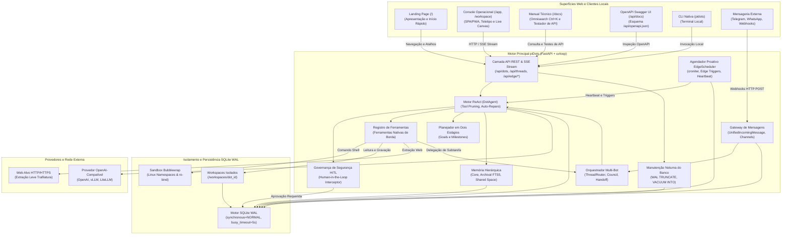
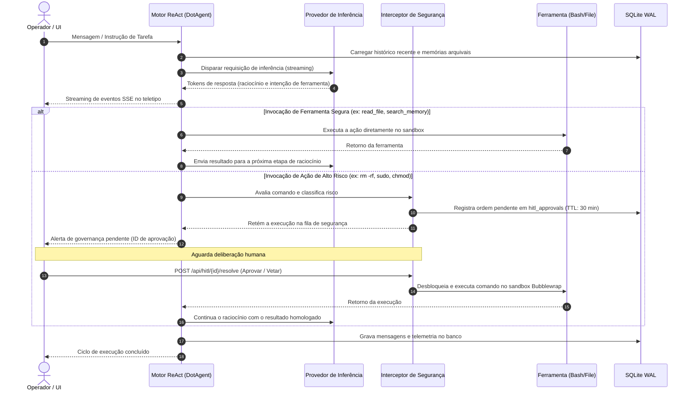
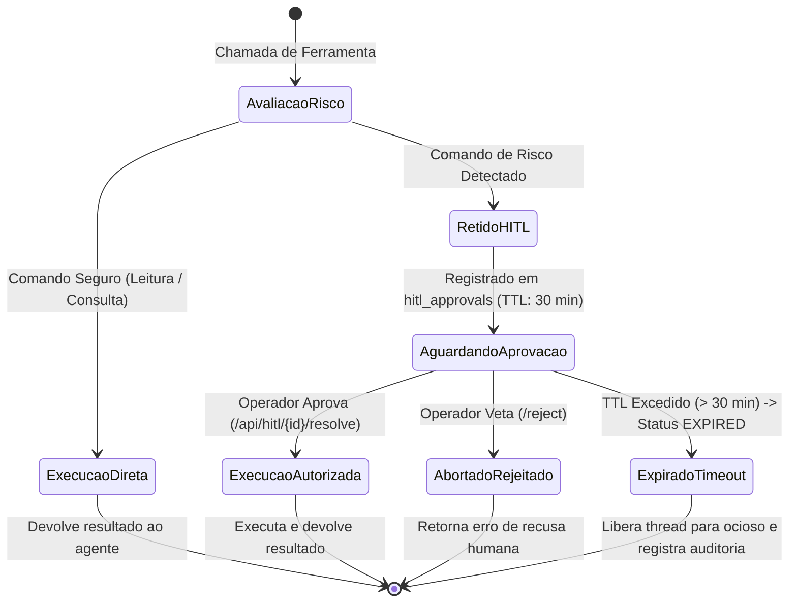
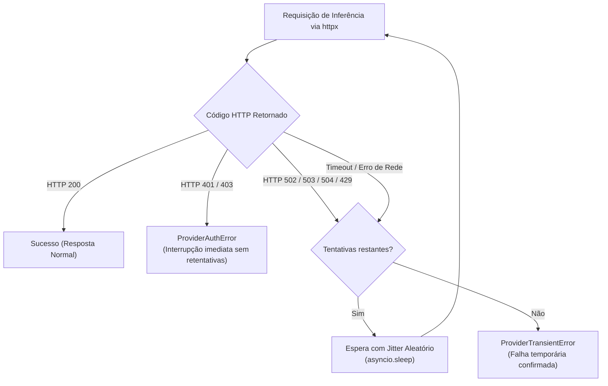

# Arquitetura e Engenharia de Software do piDots

Este documento detalha as decisões de engenharia, os padrões arquiteturais, o modelo de concorrência e as otimizações de baixo nível adotadas no **piDots**. O sistema foi concebido especificamente para operar 24 horas por dia em hardware restrito e computadores de placa única (SBCs ARM64 / x86_64), tendo o **Raspberry Pi 4B de 4 GB RAM** como bancada física de referência.

---

## 1. Visão Geral da Arquitetura

O piDots foi construído como um **monólito modular assíncrono** (Single-Process, Event-Driven). Não usamos microsserviços pesados nem enxames de contêineres que consomem gigabytes de memória antes mesmo de receber a primeira requisição. Em vez disso, todo o núcleo roda em um único processo gerenciado por FastAPI e uvloop/AsyncIO.

O resultado é previsível e econômico: o sistema sobe em menos de dois segundos, consome menos de 50 MB de RAM em repouso e raramente ultrapassa 80 MB durante execuções concorrentes.



---

## 2. Ciclo de Execução ReAct e Intercepção de Segurança

O agente opera sob o padrão ReAct (*Reasoning and Acting*) com streaming contínuo. Ele pensa, decide qual ferramenta usar e avalia o risco da operação antes de disparar qualquer comando no sistema operacional.

Se o comando for seguro (como ler um arquivo ou buscar uma memória), a execução ocorre de forma autônoma. Se o comando apresentar risco de corrupção ou invasão de privilégios (como comandos com `sudo`, `rm -rf`, `chmod` ou redirecionamento de escrita em disco), a execução é retida imediatamente para aprovação do operador humano.



---

## 3. Máquina de Estados da Aprovação Humana (HITL)

A governança segue o princípio de recusa padrão (*deny-by-default*). O sistema não confia cegamente no modelo para executar comandos arriscados.



- **Prazo de Validade de 30 Minutos:** Cada solicitação recebe a coluna `expires_at`. Se você se ausentar da bancada e não homologar o comando em 30 minutos, a ordem expira por segurança. A thread volta ao estado ocioso e o banco registra o cancelamento.
- **Abertura Automática de Painel:** Quando uma ação é retida, o servidor emite os eventos SSE `hitl:pending_approval` e `hitl:approval_required`. O console web abre a gaveta de aprovações (`Alt+H`) automaticamente.

---

## 4. Otimizações de I/O e SQLite para Cartão MicroSD e SSD

Computadores como o Raspberry Pi 4B costumam usar cartões MicroSD como armazenamento principal. A escrita síncrona contínua com chamadas `fsync()` constantes degrada a performance do sistema e esgota rapidamente a vida útil das células de memória Flash.

Para proteger o hardware, a camada de dados do piDots configura o SQLite em modo **Write-Ahead Logging (WAL)** com diretivas específicas:

```sql
-- Permite leitura e escrita simultâneas sem bloqueios no loop assíncrono
PRAGMA journal_mode = WAL;

-- Substitui o fsync completo por sincronização segura nos checkpoints periódicos
-- Poupa a vida útil do cartão MicroSD sem comprometer a integridade dos dados
PRAGMA synchronous = NORMAL;

-- Aloca 64 MB de memória RAM para cache de páginas
-- Consultas frequentes a mensagens e índices rodam direto na memória
PRAGMA cache_size = -64000;

-- Dispara checkpoint automático do WAL a cada 1.000 páginas escritas (aprox. 4 MB)
-- Evita o crescimento descontrolado do arquivo .db-wal no disco
PRAGMA wal_autocheckpoint = 1000;

-- Aguarda até 5.000 ms em transações concorrentes antes de acusar erro de lock
PRAGMA busy_timeout = 5000;

-- Mantém tabelas temporárias e ordenações transitórias na memória RAM (tmpfs)
PRAGMA temp_store = MEMORY;
```

---

## 5. Estrutura Modular do Sistema

O monólito organiza suas responsabilidades em módulos coesos dentro da pasta `pidots/`:

### 5.1 Orquestração Multi-Bot (`pidots/core/orchestrator.py`)
Coordena múltiplos especialistas locais sem sair do mesmo processo assíncrono:
- O `ThreadRouter` extrai menções `@nome_do_dot` com expressões regulares, valida se os agentes existem no SQLite e define os interlocutores da conversa.
- O `MultiBotOrchestrator.delegate_subtask()` gerencia subtarefas. O supervisor chama o especialista em uma thread secundária isolada (`subtask-{handoff_id}`), mantendo a tela principal limpa. O resultado consolidado retorna para a conversa do operador com visibilidade interna de diagnóstico.
- Se a execução do worker falhar, o orquestrador marca a subtarefa como `FAILED` na tabela `agent_handoffs`, grava o alerta técnico no banco e retorna um dicionário estruturado para que o supervisor tente outra abordagem.
- O método `handoff_lead()` transfere a liderança da conversa para outro especialista quando a tarefa mudar de área técnica.

### 5.2 Agendador Proativo Dot Heartbeat (`pidots/core/scheduler.py`)
Elimina filas externas como Celery ou RabbitMQ, rodando tarefas agendadas em segundo plano:
- O `EdgeScheduler` interpreta expressões cron com a biblioteca `croniter` e calcula a próxima execução (`next_run_at`) no SQLite.
- O loop perpétuo de verificação roda a cada 15 segundos dentro do lifespan do FastAPI.
- A diretriz `HEARTBEAT_OK` instrui o modelo a responder apenas essa frase quando tudo estiver normal. O agendador marca o ciclo como silencioso e não gera notificações desnecessárias.
- Travas em memória (`_running_tasks`) impedem que tarefas longas disparem em duplicidade se a resposta da IA demorar mais de 15 segundos.
- Um Circuit Breaker com recuo progressivo protege o sistema contra falhas sucessivas. O tempo de espera sobe de 30 segundos até 1 hora. Na 5ª falha consecutiva, o circuito abre e suspende a tarefa para não desperdiçar recursos.

### 5.3 Gateway de Mensagens e Salas Temáticas (`pidots/core/messaging_gateway.py`)
Centraliza as conexões com plataformas de mensagens sem manter estado:
- Utiliza o modelo normalizado `UnifiedIncomingMessage` para mensagens do Telegram, WhatsApp (Evolution API) e webhooks genéricos.
- A integração com a Evolution API usa chamadas HTTPx assíncronas para enviar mensagens de volta, simulando digitação sem travar a thread do servidor.
- As salas temáticas da tabela `channels` permitem discussões entre vários agentes e usuários humanos.
- Para evitar loops infinitos entre bots, o gateway impõe um limite máximo de 3 repasses (`hop_count <= 3`), exige menção direta para que um bot responda a outro e instrui respostas vazias (`NO_ACTION`) quando não houver acréscimo relevante.

### 5.4 Exportação de Workspaces (`pidots/storage/spaces_manager.py`)
Cuida do histórico de arquivos e exportação em lote:
- Ao gerar o arquivo compactado (`export_workspace_zip`), o motor reúne os arquivos físicos da pasta `/workspaces/{dot_id}` e os documentos salvos na tabela `spaces` do SQLite.
- Arquivos que ainda estejam apenas na base de dados são gravados diretamente no buffer ZIP em memória, garantindo que o arquivo baixado nunca venha vazio.

### 5.5 Notificador de Segurança (`pidots/core/notifier.py`)
Despacha alertas de governança para Webhooks HTTP e bots do Telegram. Mantém compatibilidade com versões anteriores através do alias `Notifier = HITLNotifier`.

### 5.6 Memória Hierárquica em Três Níveis (`pidots/storage/memory_manager.py`)
- **Core Memory:** Blocos de memória viva injetados no system prompt (`human`, `persona`, `active_context`). Cada bloco possui um limite rígido de 2.000 caracteres para evitar overflow de tokens.
- **Archival Memory Híbrida:** Documentos e regras duradouras salvos na tabela `archival_memories`. Triggers SQL automáticos alimentam o índice FTS5 (busca BM25). A busca híbrida combina pontuação textual com projeção vetorial compacta de 64 dimensões gerada por hash de trigramas em Python puro.
- **Recall Memory:** Busca retrospectiva em conversas anteriores da mesma thread através de consultas rápidas na tabela `messages`.

### 5.7 Auto-Reparo de Código (`pidots/core/self_healing.py`)
Analisa a saída de comandos de terminal e scripts Python. Ao detectar uma falha ou traceback, ele isola o arquivo violado, o número da linha e o tipo de erro, sugerindo uma correção direta através da ferramenta `execute_and_verify`. A rotina possui um teto de 2 tentativas para evitar ciclos repetitivos de correção.

### 5.8 Planejamento em Dois Estágios (`pidots/core/planner.py`)
Organiza metas amplas na tabela `goals` e passos detalhados na tabela `milestones`. Conforme o agente avança e comprova os resultados, ele atualiza o status de cada marco, recalculando a porcentagem de progresso dentro do bloco XML `<execution_plan>`.

### 5.9 Conselho de Revisão Técnica (`pidots/core/council.py`)
Reúne três especialistas antes de tarefas críticas: o Coder propõe a solução, o Auditor analisa riscos de segurança e estabilidade, e o Supervisor sintetiza o resultado final. O debate é limitado a no máximo 3 rodadas e opera dentro de 53 MB de RAM. Se o Auditor aprovar a proposta logo na segunda rodada, o orquestrador encerra a deliberação antecipadamente para economizar tempo e tokens.

### 5.10 Quadro de Anotações Compartilhado (`pidots/storage/shared_space.py`)
Área de anotações compartilhada entre bots de uma mesma conversa (`thread_shared_notes`). As notas são organizadas por tópicos e repassadas a todos os participantes no bloco XML `<shared_knowledge_space>`.

### 5.11 Pacotes Portáteis de Agentes (`pidots/core/dot_pack.py`)
Manifestos JSON padronizados (Dot Packs v1.1) contendo a persona, ferramentas, arquivos e memórias do agente, acompanhados de um hash criptográfico `SHA-256`. O instalador confere o hash e inspeciona o prompt contra técnicas de injeção antes de cadastrar o agente.

### 5.12 Triggers de Hardware e Sensores Físicos (`pidots/core/edge_triggers.py`)
Monitora os sensores térmicos do processador Broadcom BCM2711 via sysfs (`/sys/class/thermal/thermal_zone0/temp`), além do espaço em disco e da RAM livre. Lê pinos GPIO físicos no Raspberry Pi e recebe telemetria de sensores locais via MQTT, disparando alertas se a placa aquecer além de 72 °C.

### 5.13 Roteamento Modular da API (`pidots/api/`)
O arquivo `main.py` gerencia o ciclo de vida e middlewares da aplicação. As rotas ficam organizadas em sub-roteadores especializados:
- `routes_dots.py`: catálogo de agentes e importação/exportação de pacotes DotPack.
- `routes_hitl.py`: fila de aprovação humana e resolução remota com assinatura HMAC-SHA256.
- `routes_threads.py`: sessões de conversa e streaming SSE no protocolo AG-UI.
- `routes_tasks.py`: tarefas agendadas cron, gerenciamento de Spaces e exportação ZIP.
- `routes_channels.py`: salas temáticas de discussão colaborativa.
- `routes_webhooks.py`: recepção de mensagens externas do Telegram e WhatsApp.
- `routes_edge.py`: telemetria de hardware (`/health`), sensores térmicos e configurações a quente.
- `routes_static.py`: entrega de assets estáticos e manifesto PWA em memória RAM.

### 5.14 Isolamento com Bubblewrap (`pidots/tools/terminal.py`)
Executa comandos em sandbox Linux Bubblewrap (`bwrap`), montando `/usr`, `/bin` e `/lib` em modo somente leitura e isolando a árvore de processos. Se a variável `STRICT_SANDBOX=true` estiver definida e o binário `bwrap` não for encontrado, o comando é bloqueado com erro 126. A saída de texto tem um teto de 10 KB para proteger a memória RAM.

### 5.15 Cliente MCP Lite (`pidots/tools/mcp_client.py`)
Conecta servidores MCP externos leves via STDIO ou SSE/HTTP em Python puro, consumindo menos de 5 MB de RAM. As ferramentas importadas passam compulsoriamente pela lista de permissões de cada agente.

### 5.16 Validação Criptográfica de Aprovações (`pidots/core/hitl_crypto.py`)
Gera e valida assinaturas HMAC-SHA256 em tempo constante para aprovações enviadas a smartphones, impedindo manipulações ou acessos forjados.

---

## 6. Modelagem de Dados no SQLite WAL

O banco de dados SQLite organiza o estado da estação em tabelas relacionais eficientes:

| Tabela | Finalidade | Chaves Principais |
| :--- | :--- | :--- |
| `thread_participants` | Rastreia os agentes presentes em cada conversa | `thread_id`, `dot_id`, `is_speaker` |
| `agent_handoffs` | Registra delegações de tarefas e transferências de comando | `id`, `thread_id`, `source_dot_id`, `target_dot_id`, `status` |
| `goals` | Metas gerais de longo prazo | `id`, `dot_id`, `thread_id`, `title`, `status` |
| `milestones` | Marcos sequenciais verificáveis de cada meta | `id`, `goal_id`, `order_index`, `title`, `status` |
| `episodic_memories` | Resumos estruturados de conversas anteriores | `id`, `dot_id`, `summary`, `key_decisions` |
| `scheduled_tasks` | Rotinas periódicas agendadas (Dot Heartbeat) | `id`, `dot_id`, `cron_expr`, `next_run_at`, `consecutive_failures` |
| `channels` | Salas temáticas de discussão em equipe | `id`, `name`, `description`, `created_at` |
| `channel_messages` | Mensagens trocadas nas salas temáticas com contador de saltos | `id`, `channel_id`, `author_id`, `content`, `hop_count` |
| `channel_members` | Participantes inscritos em cada sala (bots ou humanos) | `channel_id`, `member_id`, `joined_at` |

### Índices de Consulta Rápida para MicroSD
Para garantir respostas em menos de 5 milissegundos mesmo no barramento de cartões de memória:
```sql
CREATE INDEX IF NOT EXISTS idx_participants_thread ON thread_participants(thread_id);
CREATE INDEX IF NOT EXISTS idx_handoffs_thread ON agent_handoffs(thread_id, status);
CREATE INDEX IF NOT EXISTS idx_milestones_goal ON milestones(goal_id, order_index);
CREATE INDEX IF NOT EXISTS idx_tasks_due ON scheduled_tasks(is_active, next_run_at, backoff_until);
CREATE INDEX IF NOT EXISTS idx_channel_msgs ON channel_messages(channel_id, created_at);
CREATE INDEX IF NOT EXISTS idx_channel_members ON channel_members(channel_id);
```

---

## 7. Arquétipos de Agentes e Poda de Ferramentas

### Perfis de Atuação
Os coworkers cadastrados seguem especializações bem definidas:
- **`supervisor`:** Visão estratégica, organização de etapas de trabalho e síntese executiva. Identificador: `[SPV]`.
- **`coder`:** Engenharia de software, depuração de erros, execução de comandos no sandbox e validação de testes. Identificador: `[CDR]`.
- **`arquiteto`:** Modelagem de sistemas, documentação técnica, especificação de APIs e síntese estrutural. Identificador: `[ARC]`.
- **`auditor`:** Segurança operacional, integridade de comandos shell, controle térmico e conformidade de governança. Identificador: `[AUD]`.

### Poda Dinâmica de Ferramentas (Dynamic Tool Pruning)
Enviar dezenas de definições de ferramentas JSON a cada chamada desperdiça tokens e causa lentidão na borda. No piDots, cada agente carrega apenas as ferramentas autorizadas na coluna `allowed_tools_json`. O Coder recebe ferramentas de terminal e arquivos; o Supervisor recebe ferramentas de planejamento e delegação. Essa restrição reduz em mais de 75% o volume de tokens e impede que o agente invente comandos inexistentes.

---

## 8. Isolamento de Processos com Bubblewrap (`bwrap`)

Para garantir segurança sem o peso de máquinas virtuais ou contêineres aninhados (Docker-in-Docker), o piDots usa o Bubblewrap nativo do Linux:
1. **Isolamento de Namespaces:** O processo roda em namespaces isolados de montagem de arquivos (`CLONE_NEWNS`), processos (`CLONE_NEWPID`), IPC (`CLONE_NEWIPC`) e hostname (`CLONE_NEWUTS`).
2. **Sistema de Arquivos em Modo Leitura:** Pastas críticas do sistema (`/bin`, `/usr`, `/lib`, `/etc`) são montadas como somente leitura (`--ro-bind`).
3. **Pasta de Trabalho Restrita:** O único local com permissão de escrita é o diretório atribuído ao agente (`--bind {workspaces_root}/{dot_id} /workspace`).
4. **Encerramento Automático:** A flag `--die-with-parent` assegura que processos filhos sejam finalizados imediatamente caso o processo principal seja interrompido.

---

## 9. Busca Vetorial Leve com Hash CRC32

Bancos vetoriais convencionais exigem runtimes volumosos e dependências em C++/Rust que consomem centenas de megabytes de memória.

O piDots resolve a busca semântica com uma abordagem compacta:
- O texto é decomposto em n-gramas e projetado em vetores esparsos através de funções de hashing CRC32 calculadas na CPU ARM64 em microssegundos.
- A similaridade de cosseno é calculada diretamente sobre os vetores gravados no SQLite.
- O consumo total de memória RAM é menor que **5 MB**, dispensando bibliotecas pesadas de tensores.

---

## 10. Leitura Web Assíncrona com Trafilatura

Em vez de subir instâncias completas de navegadores headless (como Chromium ou Playwright, que consomem mais de 500 MB de RAM), o piDots usa o cliente HTTP assíncrono `httpx` combinado com a biblioteca **Trafilatura**.

O extrator analisa a estrutura HTML em Python puro na CPU, descarta propagandas, scripts e estilos visuais, e devolve apenas o texto útil. O consumo de memória cai de 500 MB para cerca de 20 MB por página consultada.

---

## 11. Concorrência Assíncrona e Gestão de Silício

- O servidor roda em uma única thread com loop de eventos assíncrono (`asyncio + uvloop`).
- Leituras demoradas de disco ou execuções de comandos no sandbox são despachadas com `asyncio.to_thread` ou `create_subprocess_exec`, mantendo o loop livre para atender requisições web e transmissões SSE.
- O sistema monitora constantemente a memória residente (RSS) e a carga de CPU através do `psutil`.

---

## 12. Arquitetura de Interface e Ergonomia Mobile

As telas do piDots combinam a alta densidade de consoles técnicos clássicos com suporte ergonômico para dispositivos móveis:

### Roteamento entre Superfícies

| Superfície | Rota HTTP | Finalidade |
| :--- | :--- | :--- |
| **Landing Page** | `GET /` | Apresentação da estação, simulador ReAct e calculadora de silício |
| **Console Operacional** | `GET /app` | Estação de trabalho SPA/PWA com teletipo e Live Canvas |
| **Alias de Trabalho** | `GET /workspace` | Apelido direto para o console operacional `/app` |
| **Manual Técnico** | `GET /docs` | Documentação técnica com busca Ctrl+K e testador de API |
| **Relatório Técnico** | `GET /relatorio` | Relatório de testes de carga e validação técnica |
| **OpenAPI Swagger UI** | `GET /api/docs` | Interface Swagger nativa para desenvolvedores |
| **Esquema OpenAPI JSON** | `GET /api/openapi.json` | Contrato OpenAPI 3.0 estruturado |
| **Dicionários i18n** | `GET /data/locales/{lang}.json` | Termos traduzidos em Português e Inglês |
| **Micro-Motor de Tradução** | `GET /static/pidots-i18n.js` | Motor de tradução client-side em JavaScript puro |
| **Changelog** | `GET /api/changelog` | Notas de atualização SemVer da plataforma |
| **Service Worker** | `GET /sw.js` | Cache defensivo para carregamento imediato |

### Navegação por Teclado e Atalhos Rápidos
- Pressionar `g` seguido de `h` abre a página inicial (`/`).
- Pressionar `g` seguido de `w` abre a estação de trabalho (`/app`).
- Pressionar `g` seguido de `d` abre o manual técnico (`/docs`).

Se o operador estiver digitando em um campo de texto ou na caixa de busca, esses atalhos são desativados automaticamente para não interromper a escrita.

### Adaptação para Telas de Celular
Em telas com largura igual ou inferior a 768px:
- A barra inferior fixa traz 4 botões de toque com tamanho mínimo de 44x44 pontos: `[O] DOTS`, `[>] CHAT`, `[*] CANVAS` e `[?] GUIA`.
- O botão físico touch `[/]` permite abrir o catálogo de comandos sem precisar subir o teclado virtual.
- O sistema escuta a API `window.visualViewport`. Quando o teclado virtual abre, a barra inferior é recolhida e a caixa de digitação se ajusta na tela, impedindo que o campo fique escondido.
- Os campos de texto utilizam tamanho fixo de 16px para evitar que o navegador Safari execute zoom compulsório na tela.

---

## 13. Resiliência de Conexões e Circuit Breakers

A operação contínua 24/7 em hardware de borda exige que falhas de rede e limites de taxa de provedores de IA sejam tratados sem travar o servidor.



Erros definitivos de autenticação encerram o ciclo na hora, sem gastar energia com retentativas inúteis. Erros de rede ou sobrecarga acionam até 3 tentativas com tempos progressivos e variação aleatória.

Se a execução falhar, o evento final `run:finished` reporta o erro detalhado. O diagnóstico é registrado no banco com visibilidade interna para auditoria técnica posterior, sem poluir a tela do usuário.

---

## 14. Entrega em Quatro Portas com Proxy Nginx

Para que o servidor FastAPI concentre toda a sua capacidade de processamento no raciocínio dos agentes e no banco SQLite, o serviço `pidots-nginx` assume a entrega dos arquivos estáticos consumindo menos de 6 MB de RAM:

```mermaid
flowchart LR
    subgraph WAN["Acesso Externo / Túneis"]
        CF_Landing["pidots.seu-dominio.com"]
        CF_App["app.seu-dominio.com"]
        CF_Docs["docs.seu-dominio.com"]
    end

    subgraph TunnelDaemon["Raspberry Pi 4B (cloudflared)"]
        CFTunnel["daemon cloudflared\n(Conexão QUIC Segura)"]
    end

    subgraph NginxProxy["Nginx Alpine (< 6 MB RAM)"]
        P8081["Porta 8081\n(Apresentação)"]
        P8082["Porta 8082\n(Console SPA)"]
        P8083["Porta 8083\n(Manual Técnico)"]
        P8088["Porta 8088\n(Gateway Canônico)"]
    end

    subgraph CoreBackend["FastAPI Core (Porta 8000)"]
        CoreAPI["FastAPI uvloop\n(ReAct + SQLite WAL)"]
    end

    CF_Landing --> CFTunnel
    CF_App --> CFTunnel
    CF_Docs --> CFTunnel

    CFTunnel -->|http://localhost:8081| P8081
    CFTunnel -->|http://localhost:8082| P8082
    CFTunnel -->|http://localhost:8083| P8083

    P8081 -->|/api/| CoreAPI
    P8082 -->|/api/ (Streaming SSE)| CoreAPI
    P8083 -->|/api/| CoreAPI
    P8088 --> CoreAPI
```

As portas locais se dividem de forma clara:
- Porta `8081`: Apresentação e visão geral.
- Porta `8082`: Console operacional de trabalho (SPA/PWA).
- Porta `8083`: Manual técnico e especificações.
- Porta `8088`: Gateway de rotas com redirecionamentos automáticos.
- Porta `8000`: Backend FastAPI interno dedicado.

O script `cross-surface-router.js` detecta se o acesso vem de portas locais, da rede LAN ou de subdomínios externos, garantindo que os links e atalhos de navegação funcionem de forma transparente em qualquer ambiente.
